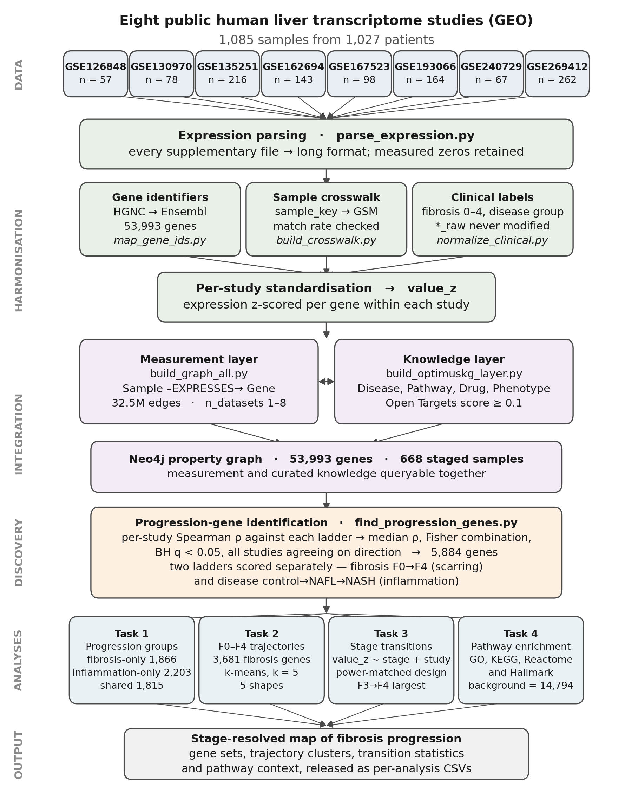
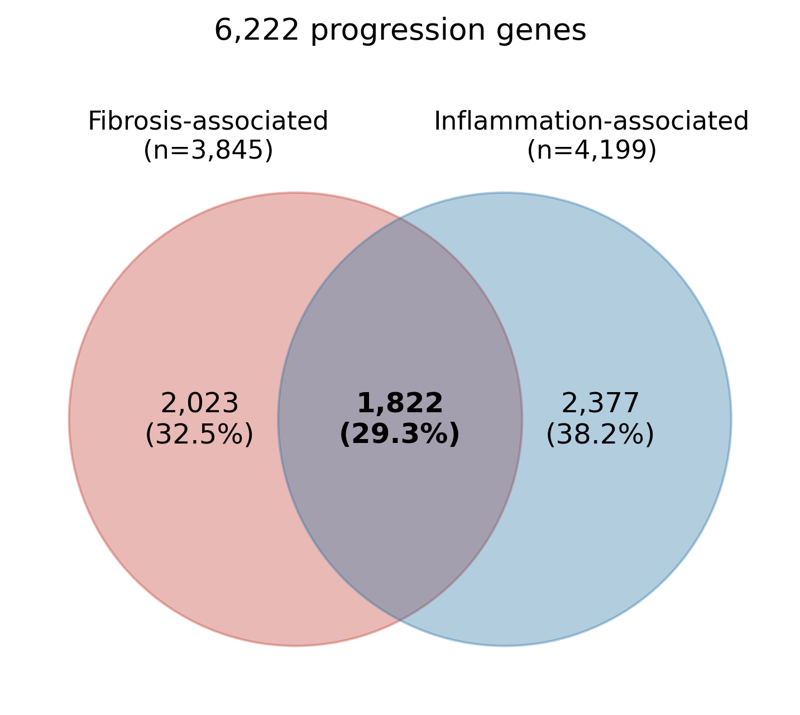
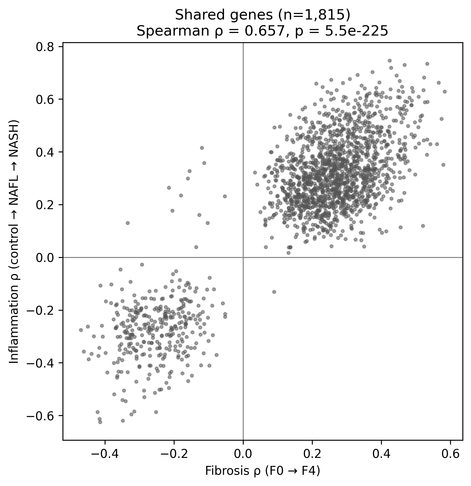
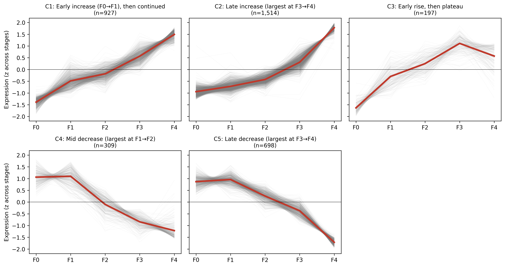
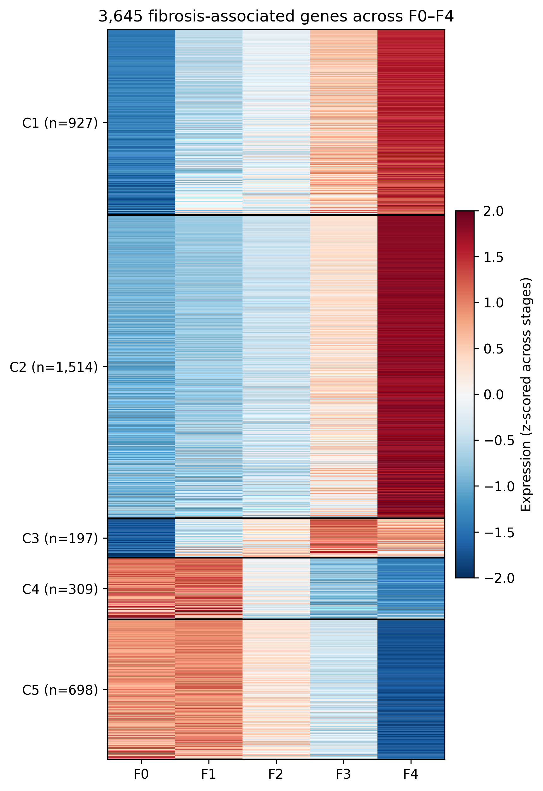
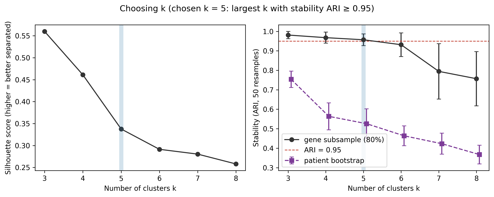
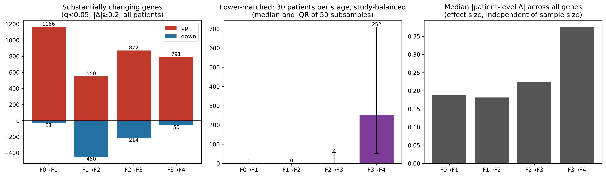
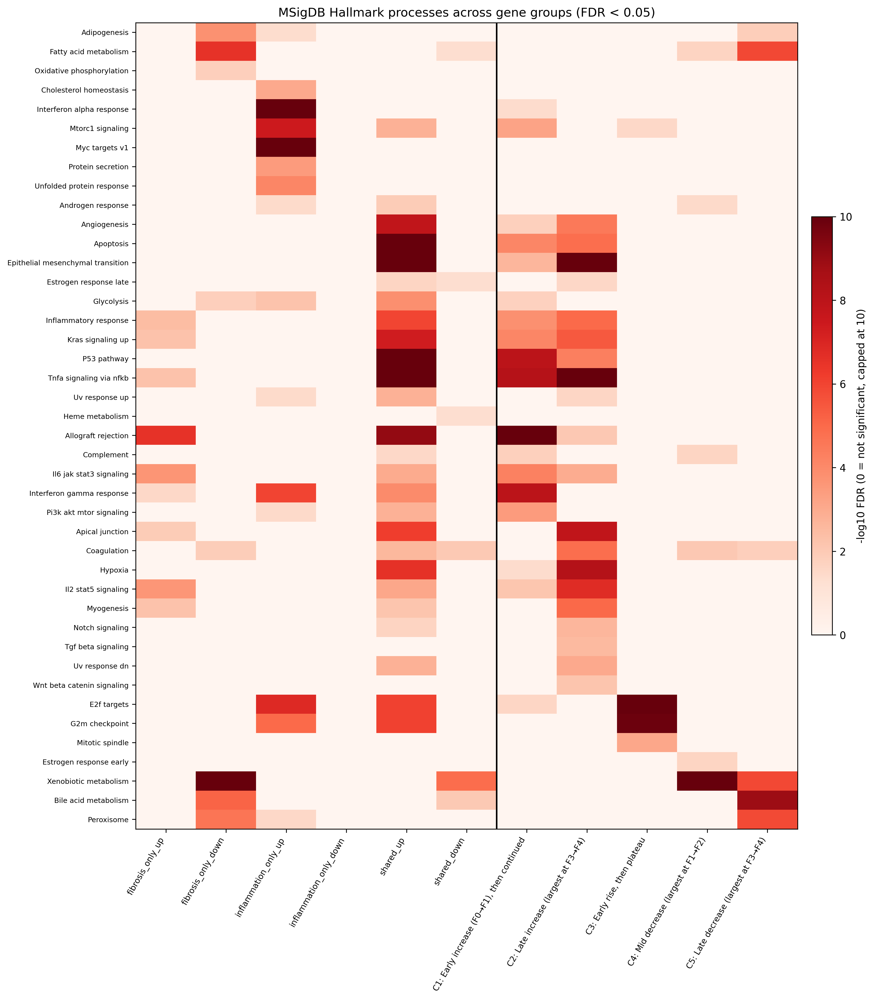
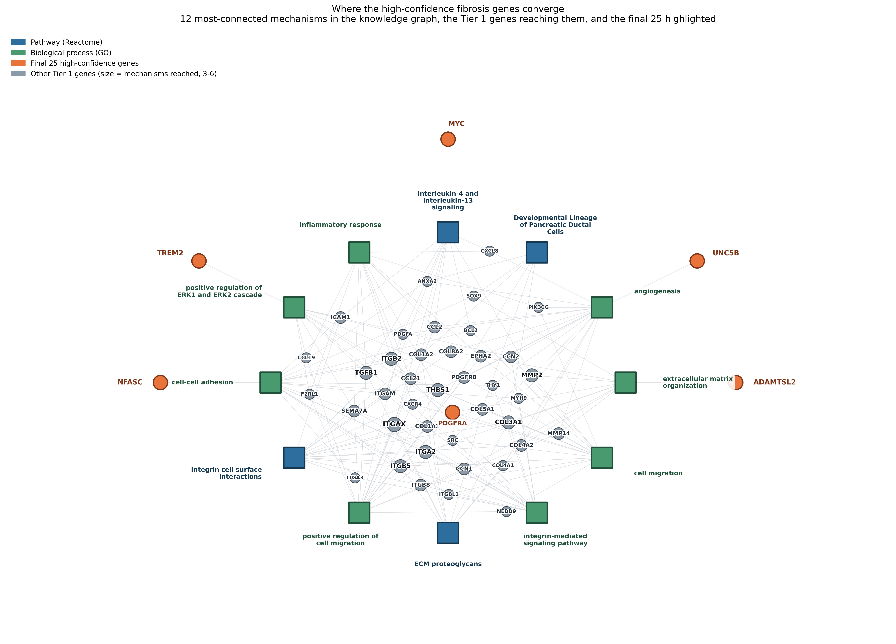
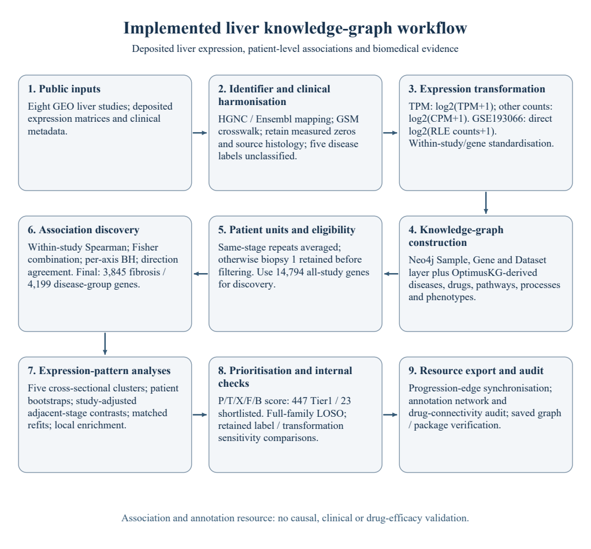

# A stage-informed liver knowledge graph integrates transcriptomic associations and biomedical evidence for future drug repurposing

**Authors:** [AUTHOR_CONFIRM: author names and order]

**Affiliations:** [AUTHOR_CONFIRM: numbered institutional affiliations]

**Corresponding author:** [AUTHOR_CONFIRM: name]*; [AUTHOR_CONFIRM: postal address and email]

**Draft status:** Complete first draft for researcher review, prepared 11 October 2026. Based solely on the approved combined analysis. Author approval, final displays, public deposition and outstanding declarations remain pending. Drafting sequence: Results, Methods, Introduction, Discussion, Abstract. Code, datasets and analysis outputs were not edited.

**Keywords:** liver fibrosis; transcriptomics; knowledge graph; gene prioritisation; biomedical data integration; drug repurposing

## Abstract

Integrating liver gene expression with biomedical knowledge may support future stage-informed drug repurposing, provided molecular associations remain distinct from therapeutic evidence. We constructed a knowledge graph integrating eight public human liver transcriptome studies comprising 1,085 samples and 1,027 recorded patient identifiers. Using a common repeat-biopsy policy, patient-level analyses included 610 fibrosis-staged observations and 216 observations with ordered disease-group labels. Cross-study testing identified 3,845 fibrosis-associated and 4,199 disease-group-associated genes, with 1,822 shared genes and a union of 6,222. Five cross-sectional fibrosis expression patterns informed annotation and prioritisation, yielding 447 Tier1 genes and 23 shortlisted genes. Among Tier1 genes, 442 remained significant in all five leave-one-study-out refits, providing evidence of internal robustness. The graph contained 126,244 nodes and 35,132,831 relationships. A filtered annotation view comprised 42 genes, 12 annotations and 154 connections. A drug-connectivity audit identified 449 drugs linked to 17 shortlisted genes through relations that included drug metabolism. Derived-label uncertainty, conditional cluster confidence and limited advanced-stage sampling constrain interpretation. This resource supports a separate team's future repurposing investigations without establishing causal mechanisms, clinical prediction, external validation or drug efficacy.

## Introduction

Fibrosis stage provides a clinically relevant framework for studying fatty liver disease. In a longitudinal cohort of patients with nonalcoholic fatty liver disease (NAFLD), fibrosis stage was associated with long-term mortality, transplantation and liver-related events [1]. A subsequent prospective study associated advanced fibrosis stages with hepatic decompensation and death [2]. These findings motivate investigation of molecular variation across fibrosis stages. However, stage-associated gene expression does not establish that modifying a particular gene will improve clinical outcomes.

Contemporary terminology recognises metabolic dysfunction-associated steatotic liver disease (MASLD) and metabolic dysfunction-associated steatohepatitis (MASH), defined by affirmative diagnostic criteria [3]. Public transcriptomic studies often retain earlier NAFLD, nonalcoholic fatty liver (NAFL) and nonalcoholic steatohepatitis (NASH) labels, with varying completeness of clinical metadata. Integrating these studies therefore requires preserving source definitions and diagnostic uncertainty rather than automatically relabelling participants. Fibrosis stage and ordered disease groups represent different aspects of the available clinical information and may identify different molecular associations.

Human liver expression profiling has revealed molecular differences across histological severity. Hoang and colleagues related hepatic expression to histological measures and described distinct molecular profiles within NAFLD [4]. Such analyses support investigation of stage-associated genes, but their findings depend on the handling of measurements, clinical labels, repeated biopsies and study effects. A multi-study resource can make these analytical choices and their consequences traceable alongside the biological annotations used for interpretation. Cross-sectional profiles across F0–F4 can organise expression patterns, but cannot establish the timing or direction of molecular change within an individual patient.

Biomedical knowledge graphs offer a complementary framework for linking genes to diseases, drugs, pathways and biological processes. OptimusKG integrates structured and semi-structured biomedical resources into a property graph with typed relations and metadata [5]. Drug-repurposing approaches such as TxGNN illustrate how relational knowledge can support candidate prediction through a separately trained and evaluated model [6]. A drug–gene or drug–disease connection alone, however, does not predict therapeutic benefit. Resources intended for downstream repurposing must distinguish stage-associated expression from the meaning of source relations and the clinical suitability of connected drugs.

Here, we constructed a stage-informed liver knowledge graph linking eight public human liver expression studies to biomedical knowledge. We examined associations with fibrosis and ordered disease groups, organised fibrosis-associated genes into cross-sectional stage profiles, evaluated adjacent-stage differences, and prioritised genes using documented expression and annotation features. A filtered annotation network and a relation-specific drug-connectivity audit illustrate queries supported by the resource. Our objective is to provide traceable stage-related evidence for a separate team's future drug-repurposing work. This study does not test drug efficacy, establish causal disease mechanisms, develop a validated clinical predictor or provide external validation of therapeutic targets.

## Results

### A liver expression resource linked to biomedical knowledge

The resource integrated eight public human liver transcriptome studies comprising 1,085 samples and 1,027 recorded patient identifiers (Fig. 1; Table 1). Five studies provided fibrosis-stage information for 668 biopsies. Applying the common repeat-biopsy policy yielded 610 patient-level observations for fibrosis analyses. The ordered disease-group analysis included 216 patient-level observations from three studies with informative control, nonalcoholic fatty liver (NAFL) or nonalcoholic steatohepatitis (NASH) labels. These analysis populations differed from the full resource and from one another. Patient identifiers were resolved within studies, but participant independence across accessions was not established.

## Table 1. Public-study coverage and deposited inputs

Counts describe the full resource rather than the independent analysis sample size. Staged biopsies and labelled samples include repeat measurements and labels unsuitable for the ordered disease axis.

| Accession | Samples | Recorded patients | Staged biopsies | Samples with disease labels | Deposited expression file |
|---|---:|---:|---:|---:|---|
| GSE126848 | 57 | 57 | 0 | 57 | GSE126848_Gene_counts_raw.txt.gz |
| GSE130970 | 78 | 78 | 78 | 73 | GSE130970_all_sample_salmon_tximport_TPM_entrez_gene_ID.csv.gz |
| GSE135251 | 216 | 216 | 216 | 216 | GSE135251_RAW.tar |
| GSE162694 | 143 | 143 | 143 | 143 | GSE162694_raw_counts.csv.gz |
| GSE167523 | 98 | 98 | 0 | 98 | GSE167523_Raw_gene_counts_matrix.txt.gz |
| GSE193066 | 164 | 106 | 164 | 0 | GSE193066_NAFLD.HUn164.gct.gz |
| GSE240729 | 67 | 67 | 67 | 0 | GSE240729_merged.counts.67samp.txt.gz |
| GSE269412 | 262 | 262 | 0 | 0 | GSE269412_DRX0FLO_rnaseq_count_mat.txt.gz |

The resource contains 1,085 samples, 1,027 recorded patient IDs and 668 staged biopsies. Analyses use 610 staged patient units and 216 disease-group patient units. GSE193066 includes 106 patients and 164 biopsies; 28 equal-stage pairs are averaged, whereas 30 differing-stage pairs retain biopsy 1. GSE130970 has five unclassified cases and 73 remaining derived labels. Broad NAFLD labels are not assigned to NAFL/NASH. GSE130970 uses TPM, and GSE193066 uses deposited linear RLE-normalised counts; other matrices follow the documented count-processing branch. Clinical source and assay review remains necessary before submission. Sources: Table1_cohort.csv and DATA_SOURCES.md. Raw values remain unchanged.

## Figure 1. Resource construction and analysis design

Eight public human liver expression studies were harmonised and linked to biomedical knowledge. The full resource comprises 1,085 samples/biopsies and 1,027 recorded patient IDs. Fibrosis and disease-group analyses include 610 and 216 patient-level observations, respectively. The common biopsy policy averages repeat biopsies with equal stages and otherwise retains biopsy 1 before filtering. Association discovery, cross-sectional profiles, adjacent-stage comparisons, annotation, prioritisation and downstream connectivity represent distinct evidence layers. Original asset: Paper1_Results/Figure1/figure1_pipeline.png. Final labels and dimensions require proofing against this caption.

The harmonised graph contained 53,993 genes, including 14,794 measured in all eight studies. Integration of expression and clinical metadata with the OptimusKG-derived knowledge layer produced 126,244 nodes across eight types and 35,132,831 relationships across 14 types. The node types were Gene, Sample, Dataset, Disease, Drug, Pathway, BioProcess and Phenotype. Expression measurements accounted for 32,471,042 relationships, and 8,044 gene–disease relationships represented the selected fibrosis and disease-group associations. Patient identity was stored as a Sample property rather than a separate Patient node. The final synchronisation record confirmed that progression-link properties agreed with the approved exports and that raw expression values and curated relationship counts were preserved. The knowledge layer retained broader biomedical coverage rather than restricting disease nodes to liver conditions.

### Partially overlapping gene associations with fibrosis and disease groups

Within-study association testing identified 3,845 fibrosis-associated and 4,199 disease-group-associated genes after false-discovery-rate correction and agreement in direction across all testable studies, with at least three contributing studies per gene. The respective test families contained 14,794 and 14,784 genes. The selected sets shared 1,822 genes and formed a union of 6,222 genes (Fig. 2), including 2,023 fibrosis-only and 2,377 disease-group-only genes.

## Figure 2. Overlap and direction of fibrosis and disease-group associations

(a) Overlap between the selected sets of 3,845 fibrosis-associated and 4,199 disease-group-associated genes, with 1,822 shared genes and a union of 6,222. Selection requires q<0.05, agreement in association direction across every testable study and at least three contributing studies. (b) Median within-study correlations for shared genes: 1,408 show concordant positive associations and 384 concordant negative associations, whereas 30 show discordant directions. Disease groups represent ordered source control/NAFL/NASH labels rather than a direct inflammation score. Proposed assets: Task1/task1_venn.png and task1_shared_rho_scatter.png. The composite remains unassembled.

Among fibrosis-only genes, 1,040 had positive and 983 negative associations. Disease-group-only genes were predominantly positively associated with the ordered labels, with 2,042 positive and 335 negative associations. Among shared genes, 1,408 were positively associated with both axes and 384 negatively associated with both. The remaining 30 were negatively associated with fibrosis but positively associated with disease-group ordering. Thus, overlap did not imply concordant directions for every shared gene. “Fibrosis-only” and “disease-group-only” describe selection outcomes across different study sets, not biological specificity. The disease-group axis did not directly measure lobular inflammation, despite historical “inflammation” names in files and graph relationships.

### Five cross-sectional fibrosis expression patterns with unequal stability

Clustering the five-stage expression profiles of the 3,845 fibrosis-associated genes yielded five groups (Fig. 3; Table 2). C1 contained 857 genes showing an early increase followed by continued elevation; C2 contained 1,367 genes showing a late increase, largest between F3 and F4; C3 contained 226 genes showing an early rise followed by a plateau; C4 contained 397 genes showing a mid-stage decrease; and C5 contained 998 genes showing a late decrease. These patterns describe expression across patients at different stages rather than serial molecular trajectories within individuals.

## Table 2. Cross-sectional clusters, confidence cores and prioritisation

| Cluster | Pattern | Genes | Confidence core>=0.8 | Tier1 | Shortlist | Mean F0 | Mean F4 |
|---|---|---:|---:|---:|---:|---:|---:|
| C1 | Early increase (F0→F1), then continued | 857 | 90 | 93 | 5 | -0.295 | 0.515 |
| C2 | Late increase (largest at F3→F4) | 1367 | 806 | 262 | 5 | -0.227 | 0.86 |
| C3 | Early rise, then plateau | 226 | 74 | 7 | 5 | -0.27 | 0.136 |
| C4 | Mid decrease (largest at F1→F2) | 397 | 126 | 3 | 3 | 0.161 | -0.279 |
| C5 | Late decrease (largest at F3→F4) | 998 | 742 | 82 | 5 | 0.184 | -0.658 |

Stage means represent averaged standardised gene expression on the original within-study standard-deviation scale, not row-z-scored centroids or fold changes. Cluster shapes were fitted to row-standardised profiles. Confidence is conditional on valid centroid matches and does not imply external validation. Tier1 requires score>=7, with up to five genes selected per cluster; thresholds were not lowered for C4. Sources: Table3_trajectory_clusters.csv, TableS5_cluster_stability.csv and the final Tier1/shortlist tables.

## Figure 3. Five cross-sectional fibrosis expression patterns

(a) Cluster expression profiles across F0–F4. (b) Heatmap of gene expression profiles. (c) Diagnostics for k, distinguishing stability under gene subsampling from stability under patient bootstrapping. Cluster sizes are 857, 1,367, 226, 397 and 998; 1,838 genes meet the conditional membership-confidence threshold of >=0.8. Clustering uses row-standardised five-stage means, which represent neither longitudinal patient trajectories nor expression fold changes. Proposed assets: Task2/task2_cluster_trajectories.png, task2_heatmap.png and task2_choosing_k.png. Existing line/band and heatmap display conventions require confirmation during final visual QA; no unsupported confidence-interval interpretation is assigned here.

Gene-subset stability supported the five-cluster solution under the documented selection rule. The mean adjusted Rand index (ARI) was 0.983 with a standard deviation of 0.011, compared with a mean patient-bootstrap ARI of 0.592 with a standard deviation of 0.062. Stability was therefore greater under gene subsampling than under patient resampling. The corresponding silhouette score was 0.352. In the subsequent centroid-matching bootstrap analysis, median shape correlations ranged from 0.967 to 0.996, although minimum correlations were negative for C2, C3 and C5. High median correlations thus did not indicate uniformly successful shape recovery.

A total of 1,838 genes met the membership-confidence threshold of 0.8: 90 in C1, 806 in C2, 74 in C3, 126 in C4 and 742 in C5. Confidence was conditional on the documented valid centroid-match denominator, reported for each gene. These core-set distributions indicate that support for individual gene memberships varied across clusters.

### Adjacent-stage contrasts were sensitive to sample size and resampling

Study-adjusted adjacent-stage models identified 857 substantial changes between F0 and F1, 1,048 between F1 and F2, 1,116 between F2 and F3, and 781 between F3 and F4 within the preselected fibrosis gene set (Fig. 4a; Supplementary stage-contrast tables). Substantial changes required q<0.05 and an absolute stage coefficient of at least 0.2 within-study standard-deviation units. The corresponding numbers of increasing/decreasing genes were 822/35, 459/589, 792/324 and 723/58.

## Figure 4. Adjacent-stage comparisons and functional annotation

(a) Full and patient-matched adjacent-stage results within the preselected set of 3,845 fibrosis genes. Substantial changes require study-adjusted q<0.05 and |beta|>=0.2 in within-study standard-deviation units. The full analyses identify 857, 1,048, 1,116 and 781 substantial changes; matched estimates use 50 draws of 30 patients per stage across four studies. F4 contributes 34 patient units to the full final contrast. (b) Hallmark over-representation analysis of direction groups, full clusters and confidence cores using MSigDB2024.1.Hs, hypergeometric tests and BH adjustment within each group/collection. Gene-set sizes are 10–500 within the 14,794-symbol background. Groups with fewer than five genes are untested, rather than tested with null results. Proposed assets: Task3/task3_transition_comparison.png and Task4/task4_heatmap_hallmark.png. The composite and final panel layout remain unassembled.

The full contrasts included 152/160, 160/152 and 152/112 patient observations for the first three stage pairs, each across five studies. The F3–F4 contrast included 86/34 observations across four studies represented at both stages. Median absolute coefficients were 0.160, 0.186, 0.224 and 0.352 across the four contrasts. These coefficients represent standardised expression differences, not fold changes.

Matched refits using 30 patients per stage across four common studies yielded mean substantial-gene counts of 12.42, 10.22, 77.02 and 369.46, with standard deviations of 67.6, 34.4, 154.2 and 383.4. The corresponding medians were 0, 0, 1 and 232.5. These broad distributions, particularly for F3–F4, limit interpretation of differences in transition counts as evidence of distinct biological transition intensity. The comparisons also remain conditional on gene selection for fibrosis association before stage-contrast fitting.

### Functional annotation varied across direction groups and cluster cores

Over-representation analysis linked the selected groups and clusters to GO Biological Process, KEGG legacy, Reactome and Hallmark gene sets (Fig. 4b; Supplementary enrichment tables). The increasing fibrosis-only group was enriched for T-cell activation (fold enrichment 2.281; q=8.19×10^-9) and the Hallmark IL6–JAK–STAT3 signalling set (fold enrichment 3.556; q=2.14×10^-5). These findings reflect annotated group membership rather than demonstrated pathway activation in a particular cell type.

Significant-term counts varied across clusters. C1 had 370 GO Biological Process and 18 Hallmark terms, whereas C2 had 518 and 20, respectively. C4 had no significant GO Biological Process terms but had one KEGG, one Reactome and three Hallmark terms. Restricting analyses to membership-confidence cores changed the annotation results: the C4 core retained one significant Reactome term and no significant terms in the other three collections. For C2, 19 of 21 significant core Hallmark terms also appeared in the full cluster; for C5, all five did. Annotation agreement therefore varied by cluster and collection. Because gene sets overlap, significant-term counts do not represent independent biological processes.

### Prioritisation yielded 447 Tier1 genes and a 23-gene shortlist

The combined P/T/X/F/B evidence score identified 447 Tier1 genes at a threshold of seven points: 93 in C1, 262 in C2, seven in C3, three in C4 and 82 in C5. Selecting up to five qualifying genes per cluster yielded 23 shortlisted genes (Table 3). C4 contributed only three genes; the score threshold was not lowered to fill the original 25-gene quota. PDGFRA, CACNA1C, TPM4, PLK3 and TAX1BP3 scored nine, and the remaining shortlisted genes scored seven or eight. The score ranks evidence within the resource rather than estimating the probability of target validity or therapeutic benefit.

## Table 3. Final 23-gene shortlist

| Gene | Cluster | Score /9 | Median fibrosis rho | Membership confidence | Valid bootstrap denominator | Largest absolute contrast |
|---|---|---:|---:|---:|---:|---|
| IL32 | C1 | 8 | 0.522 | 0.83 | 100 | F0→F1 |
| EPHA3 | C1 | 8 | 0.498 | 0.46 | 100 | F2→F3 |
| LYZ | C1 | 8 | 0.487 | 0.83 | 100 | F0→F1 |
| NFASC | C1 | 8 | 0.532 | 0.54 | 100 | F2→F3 |
| PLPP4 | C1 | 8 | 0.533 | 0.58 | 100 | F2→F3 |
| PDGFRA | C2 | 9 | 0.417 | 0.68 | 97 | F2→F3 |
| CACNA1C | C2 | 9 | 0.447 | 0.89 | 97 | F3→F4 |
| TPM4 | C2 | 9 | 0.403 | 0.89 | 97 | F3→F4 |
| PLK3 | C2 | 9 | 0.414 | 0.89 | 97 | F3→F4 |
| TAX1BP3 | C2 | 9 | 0.408 | 0.92 | 97 | F3→F4 |
| TREM2 | C3 | 8 | 0.469 | 0.67 | 99 | F0→F1 |
| CDC45 | C3 | 7 | 0.401 | 0.75 | 99 | F0→F1 |
| HTR7 | C3 | 7 | 0.44 | 0.71 | 99 | F2→F3 |
| FABP5 | C3 | 7 | 0.464 | 0.73 | 99 | F0→F1 |
| TYMS | C3 | 7 | 0.489 | 0.61 | 99 | F0→F1 |
| OAT | C4 | 7 | -0.398 | 0.38 | 100 | F2→F3 |
| KNG1 | C4 | 7 | -0.312 | 0.71 | 100 | F1→F2 |
| F2 | C4 | 7 | -0.307 | 0.56 | 100 | F1→F2 |
| SULT1E1 | C5 | 8 | -0.414 | 0.99 | 96 | F3→F4 |
| SLC38A4 | C5 | 8 | -0.43 | 0.99 | 96 | F3→F4 |
| CYP2C19 | C5 | 8 | -0.443 | 0.76 | 96 | F1→F2 |
| ACADSB | C5 | 8 | -0.447 | 0.89 | 96 | F1→F2 |
| MME | C5 | 8 | -0.421 | 0.99 | 96 | F3→F4 |

Scores combine non-independent expression and annotation features. The largest contrast reflects a gene-level fitted coefficient and does not necessarily coincide with the transition defining the cluster's average pattern. Per-gene q-values, stage means, component scores, matched reproducibility and LOSO results are retained in the full source supplement. Source: Paper1_Package/02_TABLES/main/Table6_prioritised_genes.csv. Historical filenames containing 25 refer to the original selection target rather than the final row count.

Gene-specific uncertainty remained within the shortlist. Membership confidence ranged from 0.38 for OAT to 0.99 for several C5 genes. EPHA3, NFASC, PDGFRA and TREM2 had confidence values of 0.46, 0.54, 0.68 and 0.67, respectively. A high prioritisation score therefore did not guarantee high-confidence cluster timing.

In leave-one-study-out (LOSO) refits with BH correction over the full 14,794-gene family, 442 of 447 Tier1 genes remained significant in all five omissions. A smaller subset, 247 of 447, retained an absolute median correlation of at least 0.30 throughout. These findings assess internal robustness of previously selected genes, not external or nested predictive validation. In the retained historical label/transformation comparison, 16 genes were shortlisted in all four specified variants. These variants document sensitivity to the two examined choices and do not represent additional final result sets.

### An annotation subgraph and drug-connectivity audit illustrate downstream use

The selected annotation view contained 42 genes, 12 mechanism-labelled annotations and 154 gene–annotation connections (Fig. 5). Enriched annotations included extracellular matrix organisation (27 Tier1 genes; fold enrichment 7.77; q=1.06×10^-13), angiogenesis (36; 4.69; q=8.60×10^-12) and signalling by PDGF (12; 12.81; q=1.28×10^-8). Pathway and BioProcess nodes connected separately to genes rather than forming a demonstrated causal cascade. The selected set also included “Developmental Lineage of Pancreatic Ductal Cells”. This cross-tissue annotation requires biological review and does not establish pancreatic development in liver samples.

## Figure 5. Selected Tier1 gene–annotation connections

The filtered view contains 42 genes, 12 selected Pathway/BioProcess annotations and 154 links. Annotation selection uses the 14,794-gene Ensembl background, BH adjustment across annotations reached by Tier1 genes, a background size of 10–500, at least 10 Tier1 genes and q<0.05, followed by redundancy filtering based on Jaccard similarity between Tier1 member sets. Displayed genes reach at least three selected annotations or are shortlisted genes reaching at least one. PDGFRA connects to five selected annotations; EPHA3, NFASC and TREM2 each connect to one. Only four of the 23 shortlisted genes appear. Connections represent annotations rather than a causal cascade. The pancreatic ductal developmental term requires biological review. Asset: Paper1_HighConfidence/12_mechanistic_subgraph.png; evidence workbook: 12_KG_supplementary.xlsx, sheets 3–5. The existing symbol/colour legend requires final visual confirmation.

Only four shortlisted genes appeared in the filtered view: PDGFRA connected to five selected annotations, whereas EPHA3, NFASC and TREM2 each connected to one. The display therefore did not demonstrate universal annotation convergence among the 23 shortlisted genes.

A separate audit of the saved graph exports identified 449 unique drugs connected to 17 shortlisted genes, including 184 with target-action links. The broader 449-drug total also included enzyme, carrier and transporter relations that may reflect drug metabolism or disposition. Among the connected drugs, 101 had broad liver/biliary indication annotations and 11 had NAFLD/NASH indication annotations. Liver/biliary contraindication and off-label annotations were counted separately, involving 98 and two drugs, respectively. These relation-specific sets may overlap, and recorded indications were not checked for regulatory approval or clinical efficacy. The audit illustrates retrievable biomedical connections; it neither ranks repurposable drugs nor establishes therapeutic direction or an effect on disease progression.

## Discussion

This study presents a stage-informed liver knowledge graph integrating public transcriptomic measurements, clinical-stage associations and biomedical annotations in a traceable resource. The approved combined analysis identified 3,845 fibrosis-associated and 4,199 disease-group-associated genes, including 1,822 shared genes, and prioritised 447 Tier1 genes with a 23-gene shortlist. These outputs enable investigation of molecular associations in relation to disease stages and existing biomedical knowledge. They do not establish that modulating a shortlisted gene or administering a connected drug will interrupt disease progression.

The resource integrates study-specific stage evidence with a broader biomedical graph without treating every knowledge-layer connection as a liver-specific therapeutic observation. Previous liver transcriptomic research related expression to histological severity and molecular heterogeneity [4], while general graphs such as OptimusKG provide typed biomedical relationships [5]. Integrating these evidence layers makes expression coverage, association direction, stage patterns and annotation context available for downstream investigation. The contribution is the assembled resource and its documented prioritisation analyses; superiority over other graphs or drug-repurposing models was not evaluated.

Distinguishing fibrosis from disease-group associations is essential for interpretation. Although fibrosis has prognostic relevance in observational clinical cohorts [1,2], selection on that axis alone does not establish a gene's specificity to fibrosis biology. Sample sizes, contributing studies, clinical definitions and testability all affect selection. Disease-group ordering approximates the ordering of source labels rather than directly quantifying inflammation. The 30 shared genes with discordant directions further illustrate how a pooled “progression signature” could obscure differences between the axes. The graph retains these distinct associations without interpreting either as a causal progression model.

The five expression patterns organise cross-sectional data, but their timing labels require caution. Gene-subset stability was high, whereas patient-bootstrap agreement was appreciably lower. Strong median centroid correlations also coexisted with failed or negatively correlated matches, and only 1,838 of 3,845 genes met the conditional confidence threshold. These findings support reporting cluster-level summaries alongside gene-level confidence. A high score with uncertain membership may inform association-based prioritisation but provides weaker support for a particular stage-specific expression pattern. Despite repeat biopsies in one source study, none of the profiles establishes an individual patient's molecular course over time.

The adjacent-stage results likewise require separation of effect estimates from apparent transition intensity. The full F3–F4 analysis included only 34 F4 patient observations, and matched refit counts were highly variable. Earlier contrasts also had low matched medians despite larger full-analysis counts. Differences in significant-gene counts therefore reflect statistical power, patient composition and selection procedures alongside possible biological variation. Adjustment for study does not eliminate clinical confounding or changes in cell composition, and testing within the previously selected fibrosis set makes these comparisons conditional on discovery. The contrasts can inform hypotheses but do not establish discrete biological switches or treatment windows.

The prioritisation scheme combines complementary aspects of shared evidence rather than independent confirmations. Association magnitude, stage differences and contrast reproducibility draw on the same expression data, while annotation collections share genes and terms. The F feature also depends on comparison with a disease axis containing derived labels. Tier1 thresholds and cluster quotas are operational choices, not calibrated probabilities of target validity. The limited number of qualifying C4 genes was reflected in a 23-gene shortlist without relaxing the threshold. LOSO results showed substantial retention of statistical significance, but the reduction from 442 significant genes to 247 retaining the effect-magnitude criterion across all refits demonstrates the limits of significance alone. Selection was not fully nested, and no independent cohort, clinical prediction model or prospective validation was assessed.

Biological annotations provide context rather than experimentally established mechanisms. Extracellular matrix, migration and vascular annotations were enriched in the Tier1 set. Independent single-cell research has described fibrosis-associated macrophage and mesenchymal populations, including TREM2-positive macrophages and PDGFRα-positive collagen-producing cells [7]. This context motivates cell-resolved follow-up but does not identify the cellular origin of our bulk-liver associations or establish whether inhibiting or increasing a shortlisted gene would be beneficial. Similarly, shared gene membership may explain the pancreatic ductal developmental annotation, but the current evidence does not establish this process in liver tissue. Only four shortlisted genes appeared in the selected annotation view, limiting claims of convergence across the full shortlist.

Drug connectivity illustrates a potential application of the graph, with conclusions dependent on the meaning of each relation. The 449 connected drugs include metabolism and disposition relations, and only a subset has target-action links. Indication, contraindication and off-label annotations have distinct clinical meanings and may overlap. An indication may reflect investigational evidence rather than verified approval; conversely, absence of a recorded drug link does not establish that a gene is undruggable. The eleven drugs with NAFLD/NASH indication annotations are therefore retrievable examples, not an efficacy-supported repurposing shortlist. Unlike a trained and evaluated drug-repurposing model such as TxGNN [6], this study neither generated drug predictions nor assessed their performance. A separate team must establish therapeutic direction, stage relevance, safety and experimental efficacy before interpreting these connections as intervention candidates.

Source data and provenance impose additional limitations. Five ambiguous GSE130970 cases were assigned unclassified status, but the remaining 73 labels are still histology-derived, and original sample-level diagnoses were not recovered. Incomplete metabolic and alcohol metadata prevent reconstruction of contemporary MASLD/MASH diagnostic criteria [3]. The final analysis preserved GSE193066's deposited linear RLE normalisation. The retained comparison nevertheless shows that normalisation and label choices can affect membership and prioritisation, with sixteen shortlisted genes shared across the four specified variants. This sensitivity assessment does not establish a universally optimal transformation. Demographic stage summaries cover only 327 patient units, and participant overlap across accessions remains incompletely assessed. The common biopsy policy reduces duplicate contribution within studies but cannot resolve these broader dependencies.

Current tables, documented parameters, source audits and verification records support reproducibility, but the package is not a complete raw-data or database backup. The recovered expression input covers the shared analysis core rather than all graph measurements. Exact HGNC and OptimusKG release metadata, parts of the original acquisition chain and public code/graph deposition links remain incomplete. These gaps must be resolved or explicitly acknowledged in the availability statement before submission. No prospectively registered protocol establishes that all analytical choices preceded inspection of the results. Figure composites also require assembly and proofing at journal size.

Future work should use the resource to formulate testable, stage-informed repurposing hypotheses. Priorities include recovering uncertain clinical labels where possible, assessing cohort overlap and confounding, evaluating target and drug direction in appropriate cellular contexts, and testing candidates in independent data and experimental systems. The present contribution is a documented graph and prioritised associations with explicit uncertainty. It provides an evidence base for further investigation without claiming effective drugs, causal mechanisms, clinical prediction or external validation.

## Materials and methods

### Public expression studies and clinical metadata

We reanalysed deposited human liver expression matrices from the NCBI Gene Expression Omnibus (GEO), a public functional-genomics repository [8]. The eight accessions and corresponding sample counts were GSE126848 (57), GSE130970 (78), GSE135251 (216), GSE162694 (143), GSE167523 (98), GSE193066 (164), GSE240729 (67) and GSE269412 (262). Supplementary expression matrices and series-level sample metadata were used; no new sequencing, alignment or quantification was performed. Exact input filenames are provided in Table 1 and the source inventory. Sample size was determined by the available public samples. [AUTHOR_CONFIRM: provide original acquisition dates, study-selection/search procedure and any exclusion criteria not retained in the available inventory.]

Matrix, GCT and per-sample archive formats were parsed into sample–gene measurements. Missing and non-numeric measurements were removed, the first occurrence of duplicate rows sharing a raw gene identifier was retained, and measured zeros were preserved. Study-specific rules based on titles, descriptions and identifier prefixes linked expression columns to GSM sample records. Source clinical fields were preserved alongside derived labels, label provenance, patient identity and biopsy order.

Fibrosis stages were ordered F0–F4, and disease groups were ordered control=0, NAFL=1 and NASH=2. Broad NAFLD labels without an informative subtype, obese-only labels and unclassified records were excluded from the ordered disease axis. Contribution to discovery required at least 25 eligible patient observations and variation in the clinical axis within a study. Five studies contributed to fibrosis analyses and three to disease-group analyses. Patient identities were resolved within accessions; potential participant overlap across accessions was not comprehensively assessed.

GSE130970 classifications were derived from deposited histological component scores rather than recovered author diagnoses. Steatosis grade zero defined the control proxy, positive steatosis with positive ballooning defined the NASH proxy, and positive steatosis with zero ballooning defined NAFL. This derivation did not reproduce the source study's complete diagnostic assessment [4]. In the approved combined analysis, GSM3758028, GSM3758038, GSM3758039, GSM3758073 and GSM3758074 were assigned unclassified disease-group status, while their original histology and fibrosis stages were preserved. The remaining 73 labels were still derived and unverified. Original sample-level author diagnoses were not recovered from the inspected supplements. GSE193066 provided fibrosis information but no usable disease-group diagnoses. Source NAFLD/NAFL/NASH terminology was retained; modern MASLD/MASH eligibility was not inferred from incomplete metabolic and alcohol metadata [3].

### Gene identifiers and measurement transformations

The HGNC complete set was used to map approved symbols, Entrez identifiers and unambiguous previous symbols or aliases to canonical Ensembl gene identifiers, with Ensembl version suffixes removed. Ensembl identifiers lacking HGNC annotation were retained without adding unsupported annotations. Mapping failures were reported, and `_PAR_Y` rows were removed. Distinct raw identifiers mapping to the same canonical gene were summed. The graph retained the union of measured genes, whereas discovery was restricted to the 14,794 genes measured in all eight studies. [EVIDENCE_NEEDED: exact HGNC release/download date and immutable upstream dictionary reference.]

Expression in the GSE130970 TPM matrix was transformed as log2(TPM+1). Other deposited count matrices were transformed as log2(CPM+1), using deposited sample totals computed before gene mapping and filtering. The GSE193066 GCT contained linear DESeq2 RLE-normalised counts, as established by the saved depositor-processing audit. For this study, mapped aliases were summed before directly applying log2(count+1), preserving the deposited RLE normalisation without additional CPM rescaling. DESeq2 is cited for the source normalisation context [9]; this project neither fitted DESeq2 differential-expression models nor recovered the source size factors.

Transformed expression was standardised within each study and gene by subtracting the sample mean and dividing by the sample standard deviation (ddof=1). Where standard deviations were undefined, standardised expression was set to zero. For GSE193066, standardisation used all 164 source biopsies before the patient-level biopsy policy was applied. Standardised expression (`value_z`) and derived effects are expressed in within-study standard-deviation units, not fold-change units. No fitted cross-study batch-correction procedure or limma/edgeR model was used.

### A shared patient-level repeat-biopsy policy

Repeated biopsies were resolved before filtering for any stage contrast. When all recorded fibrosis stages for a patient's repeat biopsies were known and identical, standardised expression values were averaged. When stages differed, only biopsy 1 was retained; unknown stages were not assumed equal. This policy prevented a second biopsy from entering a contrast solely because the first biopsy fell outside its stage range. GSE193066 included 106 recorded patients and 164 biopsies, with 58 repeat pairs, consistent with the source cohort structure [10]. Twenty-eight pairs had matching stages and 30 had differing stages. Each patient contributed once to discovery, stage means, clustering/resampling, adjacent-stage contrasts, matched refits and LOSO analyses. All original biopsies and raw measurements were retained in the full graph.

### Cross-study association discovery

Within each eligible study, Spearman correlation related patient-level standardised expression to the ordered clinical axis, using average ranks for ties. Two-sided p-values were calculated using the t approximation, t=rho*sqrt((n-2)/(1-rho^2)), with n-2 degrees of freedom. Correlations were clipped to ±0.9999999 for numerical calculation. Genes required testable results in at least three studies. The median study correlation summarised the effect, and Fisher's statistic, -2*sum(log(p)), combined study p-values using 2k degrees of freedom for k contributing studies. P-values were clipped below at 10^-300.

Benjamini–Hochberg (BH) adjustment [11] was applied separately to the retained fibrosis and disease-group test families, comprising 14,794 and 14,784 genes, respectively. Selection required q<0.05 and agreement with the median direction in every testable study; no minimum absolute-correlation threshold was applied during discovery. Fisher combination and the direction filter do not eliminate residual confounding or potential participant dependence across accessions. Genes were partitioned into fibrosis-only, disease-group-only and shared sets, with concordant and discordant shared associations distinguished. The separate diagnostic file based on significance on both axes without the unanimity filter was not used to define these sets. Exported stage means averaged patient observations, and correlations were rounded to three decimal places in downstream summary/scoring inputs.

### Fibrosis profiles, clustering and stability

Five patient-weighted stage means were calculated for each fibrosis-associated gene and row-standardised across F0–F4 using ddof=0. K-means used 50 initialisations and seed 42. Diagnostics examined k=3–8, including 50 gene-subset refits using 80% of genes and 50 patient-bootstrap refits; diagnostic refits used 10 initialisations. The documented rule retained the largest k with mean gene-subset ARI>=0.95. The final k=5 solution met this rule and remained fixed in the historical label/transformation comparisons. Patient-bootstrap ARI and silhouette scores were reported separately rather than treated as interchangeable selection criteria.

An additional 100 patient bootstraps assessed gene membership and centroid shape. Hungarian assignment aligned bootstrap centroids with reference centroids. Per-gene confidence was based only on bootstrap matches to the corresponding reference cluster with centroid correlation>=0.5; valid denominators were reported alongside confidence. Core genes required confidence>=0.8. Study-adjusted categorical-stage-plus-study OLS profiles provided an additional descriptive comparison. Cluster shapes were interpreted as cross-sectional stage profiles rather than within-patient trajectories.

### Adjacent-stage contrasts and matched refits

For F0–F1, F1–F2, F2–F3 and F3–F4, standardised expression was modelled by ordinary least squares with an indicator for the higher stage and study-specific intercepts. Only studies represented at both stages contributed. Two-sided t tests evaluated the stage coefficient, and BH adjustment was applied across the selected 3,845-gene fibrosis set within each contrast. Substantial changes required q<0.05 and |beta|>=0.2. Models adjusted for study but did not comprehensively account for BMI, treatment, cell composition or other clinical confounders.

Matched comparisons used four studies represented at every stage. Within each study, the minimum available patient count across stage pools determined the common sampling allocation, yielding 30 patients per stage in total. Fifty draws sampled without replacement within study/stage using seed 42, and the same models were refitted. Effect reproducibility was defined as the fraction of draws with |beta|>=0.2 and the same sign as the full fit. Significance in matched draws was recorded separately and was not the reproducibility measure used for scoring. These analyses reused discovery-selected genes and did not provide unbiased whole-transcriptome comparisons of transition intensity.

### Gene-set over-representation

Local MSigDB 2024.1.Hs symbol-based gene sets represented GO Biological Process, KEGG legacy, Reactome and Hallmark; the construction of the Hallmark collection is described in [12]. One-sided hypergeometric over-representation tests were performed using GSEApy [13], rather than rank-based GSEA. The background comprised 14,794 eligible unique symbols. Gene sets were intersected with this background and retained at sizes of 10–500. Groups required at least five genes. BH adjustment was applied within each group/collection, with q<0.05 defining significant terms. Tests covered six concordant direction groups, five full clusters and five confidence cores. The 30 shared discordant genes were not included in the shared-up/down groups. Groups below the minimum size were labelled untested, distinguishing them from tested groups with no significant terms.

### Evidence scores, shortlist and internal robustness

Five features formed a maximum-nine-point score. P awarded two points for |median fibrosis rho|>=0.4, one for >=0.3, and zero otherwise. T awarded two points for |mean F4-mean F0|>=1 standard-deviation unit, one for >=0.5, and zero otherwise; zero was also assigned when the direction conflicted with the fibrosis association. X evaluated the largest absolute adjacent-stage coefficient: two points required both a substantial full-fit change and effect reproducibility in at least 50% of matched draws, whereas one point required either condition. F awarded one point for membership in the fibrosis-only selected set. B awarded two points for enrichment membership in at least two annotation collections and one point for one collection, based on the gene's own group or cluster.

Tier1 required a total score>=7; Tier2 required >=5 below Tier1. Up to five Tier1 genes per cluster were shortlisted, ranked by total score and then absolute median fibrosis correlation. C4 contained only three qualifying genes, yielding 23 rather than forcing the historical target of 25. The five features reuse expression and annotation information and do not constitute five independent validations.

LOSO analyses omitted each of the five fibrosis studies in turn, repeated the patient policy and association calculations, and applied BH across the full 14,794-gene eligible family in every refit. Summaries for previously selected Tier1 genes recorded significance and maintenance of |median rho|>=0.30 across all omissions. Full selection was not nested within a held-out prediction design. Historical sensitivity comparisons varied the five ambiguous labels and the GSE193066 transformation separately and jointly; the combined version was subsequently approved as final. Feature-removal, threshold and alternative-shortlist comparisons were retained as sensitivity evidence rather than adopted as alternative primary analyses.

### Knowledge-graph integration and annotation views

The biomedical layer was derived from OptimusKG, documented in its primary repository and preprint [5], with source dataset DOI 10.7910/DVN/IYNGEV. This citation identifies the source resource, not the exact historical release ingested. [EVIDENCE_NEEDED: downloaded OptimusKG version, release date, source-file checksum and source-specific redistribution terms.]

Measured genes were matched by Ensembl identifier. Gene–disease links required source association score>=0.1, and scores were retained. Symmetric gene interactions were deduplicated, while drug-action, indication, contraindication and off-label relations retained their distinct meanings. Neo4j represented eight node and 14 relationship types, including separate sample-expression and selected gene–disease progression links. `TRACKS_INFLAMMATION` is the retained implementation name for disease-group associations, not an independent measurement of inflammation.

For the annotation view, Pathway and BioProcess nodes linked directly to Tier1 genes. Hypergeometric tests used the 14,794-gene Ensembl background, with BH adjustment across 3,980 annotation nodes reached by Tier1 genes before filtering for figure eligibility. Eligible nodes had 10–500 background genes, at least 10 Tier1 genes and q<0.05. Nodes were ranked by q, and overlapping Tier1 member sets with Jaccard similarity>0.5 were collapsed sequentially before retaining 12 annotations. Displayed genes either reached at least three selected annotations or were shortlisted genes reaching at least one. Network connections represented source annotations, not experimentally demonstrated mechanisms.

The separate drug audit joined the final shortlist to saved drug–gene, drug–disease and entity CSVs. Unique drug IDs were counted, distinguishing target-action links from enzyme, carrier and transporter links. The broad liver/biliary indication scope followed the audit's explicit disease-label matching rules; NAFLD/NASH indications were additionally tabulated. Contraindications and off-label annotations were retained as separate, potentially overlapping sets. Regulatory status, efficacy, dose, therapeutic direction and stage-specific suitability were not verified. No drug-prediction model was trained or evaluated in this audit.

### Software, traceability and governance

The corrected analyses used Python 3.12.14, pandas 2.3.3, NumPy 2.2.4, SciPy 1.16.3, scikit-learn 1.7.2, matplotlib 3.10.7 and GSEApy 1.3.1. The saved graph verification recorded Neo4j Enterprise 2026.09.0. Runtime requirements, parameters, source audits, current tables and verification records accompany the package. The recovered expression input covers the 14,794-gene analysis core rather than every raw graph measurement; the writing package alone cannot reconstruct the full acquisition and graph-loading chain.

This study used existing public human data and generated no new participant data. [AUTHOR_CONFIRM: institutional determination regarding secondary-data ethics review and applicable consent/data-use conditions; do not infer an exemption or invent approval identifiers.]

Claude/Codex assistance was used in project support and manuscript preparation. [AUTHOR_CONFIRM: finalise an accurate AI-use statement identifying tools, tasks and the human checks actually performed before submission; author review and approval have not been asserted in this draft.]

### Project Pipeline

The implemented workflow links deposited liver expression and clinical metadata to harmonised identifiers and transformed measurements, integrates these with the OptimusKG-derived Neo4j resource, and applies the documented patient-level biopsy policy and gene eligibility rules before association discovery. Subsequent analyses comprise cross-sectional clustering, adjacent-stage contrasts, enrichment, evidence scoring and internal robustness checks. Progression-edge synchronisation, the annotation-network view, the drug-connectivity audit and saved graph/package verification complete the resource workflow (Fig. 6). These stages are supported by the implemented scripts and approved final outputs; they do not constitute clinical or therapeutic validation.

## Figure 6. Implemented project pipeline

Implemented research workflow from deposited GEO inputs and clinical metadata through identifier harmonisation, expression transformation, Neo4j/OptimusKG integration, patient-unit selection, association discovery, expression-pattern analysis and prioritisation, to resource export and auditing. The diagram preserves the same-stage-average/otherwise-biopsy-1 policy, five unclassified disease-group labels and direct log transformation of GSE193066 linear RLE-normalised counts. Evaluation comprises internal LOSO, retained sensitivity comparisons and saved resource verification, not external validation or demonstrated drug efficacy. Source scripts and results are inspected without rerunning or changing the analyses.

## Data availability

The source expression studies are publicly available in GEO under accessions GSE126848, GSE130970, GSE135251, GSE162694, GSE167523, GSE193066, GSE240729 and GSE269412. OptimusKG source data are identified by DOI 10.7910/DVN/IYNGEV and are subject to source-specific conditions. [AUTHOR_CONFIRM: insert permanent public links/DOIs for the final graph exports, result tables, verification records and supplementary files, and state any redistribution/access restrictions.] The recovered expression analysis core does not constitute a complete backup of all graph measurements.

## Code availability

[AUTHOR_CONFIRM: insert public repository URL, immutable commit/release identifier, license and archived DOI for the exact final analysis code.] This draft does not assert that the code has been publicly released or that a complete rebuild from raw data is available.

## Acknowledgements

[AUTHOR_CONFIRM: acknowledgements and permission to name contributors.]

## Funding

[AUTHOR_CONFIRM: funding sources and grant numbers, or verified statement of no funding.]

## Author contributions

[AUTHOR_CONFIRM: contributions by each author; AI tools must not be named as authors.]

## Competing interests

[AUTHOR_CONFIRM: declarations for all authors; do not assume absence of competing interests.]

## Additional information

[AUTHOR_CONFIRM: final corresponding-author information, supplementary deposit, author approval and any journal-specific reporting requirements.]

## References

1. Angulo, P. et al. Liver Fibrosis, but No Other Histologic Features, Is Associated With Long-term Outcomes of Patients With Nonalcoholic Fatty Liver Disease. *Gastroenterology* **149**, 389–397.e10 (2015). https://doi.org/10.1053/j.gastro.2015.04.043.

2. Sanyal, A. J. et al. Prospective Study of Outcomes in Adults with Nonalcoholic Fatty Liver Disease. *N. Engl. J. Med.* **385**, 1559–1569 (2021). https://doi.org/10.1056/NEJMoa2029349.

3. Rinella, M. E. et al. A multisociety Delphi consensus statement on new fatty liver disease nomenclature. *Hepatology* **78**, 1966–1986 (2023). https://doi.org/10.1097/HEP.0000000000000520.

4. Hoang, S. A. et al. Gene Expression Predicts Histological Severity and Reveals Distinct Molecular Profiles of Nonalcoholic Fatty Liver Disease. *Sci. Rep.* **9**, 12541 (2019). https://doi.org/10.1038/s41598-019-48746-5.

5. Vittor, L. et al. Unifying biomedical knowledge in a modern multimodal graph. *arXiv* 2604.27269v3 (2026), preprint. https://arxiv.org/abs/2604.27269v3; https://doi.org/10.48550/arXiv.2604.27269.

6. Huang, K. et al. A foundation model for clinician-centered drug repurposing. *Nat. Med.* **30**, 3601–3613 (2024). https://doi.org/10.1038/s41591-024-03233-x.

7. Ramachandran, P. et al. Resolving the fibrotic niche of human liver cirrhosis at single-cell level. *Nature* **575**, 512–518 (2019). https://doi.org/10.1038/s41586-019-1631-3.

8. Edgar, R., Domrachev, M. & Lash, A. E. Gene Expression Omnibus: NCBI gene expression and hybridization array data repository. *Nucleic Acids Res.* **30**, 207–210 (2002). https://doi.org/10.1093/nar/30.1.207.

9. Love, M. I., Huber, W. & Anders, S. Moderated estimation of fold change and dispersion for RNA-seq data with DESeq2. *Genome Biol.* **15**, 550 (2014). https://doi.org/10.1186/s13059-014-0550-8.

10. Fujiwara, N. et al. Molecular signatures of long-term hepatocellular carcinoma risk in nonalcoholic fatty liver disease. *Sci. Transl. Med.* **14**, eabo4474 (2022). https://doi.org/10.1126/scitranslmed.abo4474.

11. Benjamini, Y. & Hochberg, Y. Controlling the False Discovery Rate: A Practical and Powerful Approach to Multiple Testing. *J. R. Stat. Soc. B* **57**, 289–300 (1995). https://doi.org/10.1111/j.2517-6161.1995.tb02031.x.

12. Liberzon, A. et al. The Molecular Signatures Database (MSigDB) hallmark gene set collection. *Cell Syst.* **1**, 417–425 (2015). https://doi.org/10.1016/j.cels.2015.12.004.

13. Fang, Z., Liu, X. & Peltz, G. GSEApy: a comprehensive package for performing gene set enrichment analysis in Python. *Bioinformatics* **39**, btac757 (2023). https://doi.org/10.1093/bioinformatics/btac757.

---

# Proposed display legends and manuscript tables

Draft numbering follows FIGURE_TABLE_PLAN.md. Captions describe planned composites of existing assets; no composite production or visual QA is claimed. Source tables and images are unchanged. Supplement labels remain provisional.

## Proposed supplementary inventory

The proposed supplementary material comprises complete gene-group/direction tables and test-family progression tables; cluster assignments, conditional confidence denominators, k/bootstrap diagnostics and study-adjusted checks; complete stage models and matched-refit records; full enrichment tests, significant terms and core comparisons; all scores, Tier1 membership, threshold/feature sensitivities and full-family LOSO outputs; the complete gene–annotation workbook; final-versus-historical sensitivity comparisons; the relation-specific drug audit; clinical-label, expression-unit and biopsy source audits; and manifests and verification records. S-table/S-figure numbering should be finalised only after the files are assembled. This draft does not represent missing supplementary material as newly assembled.
