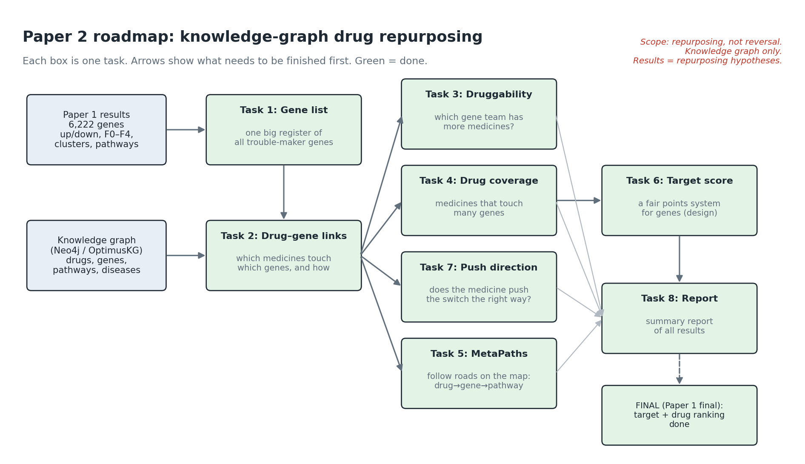
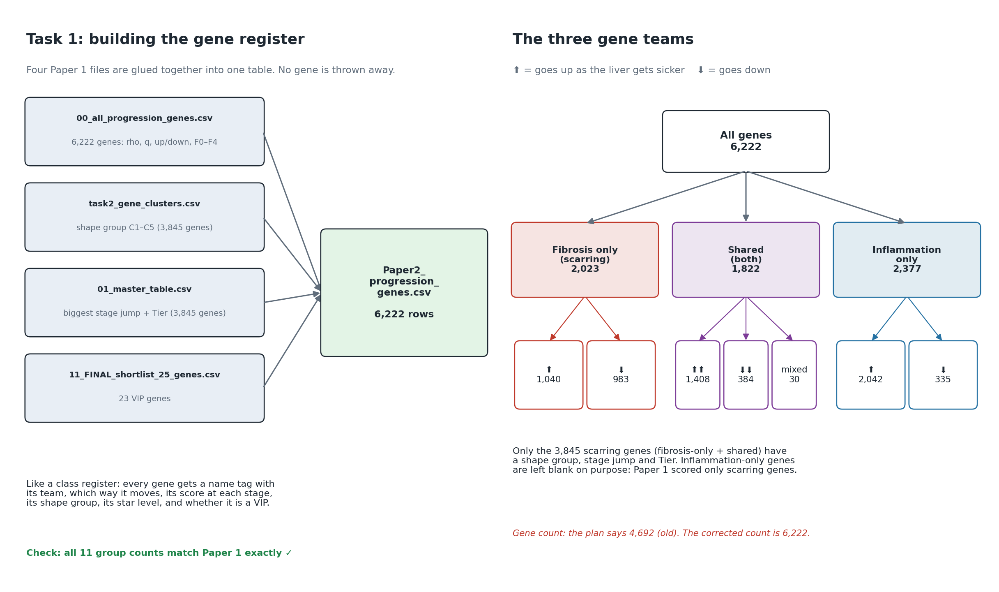
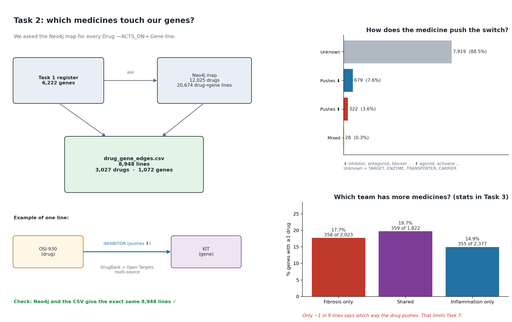
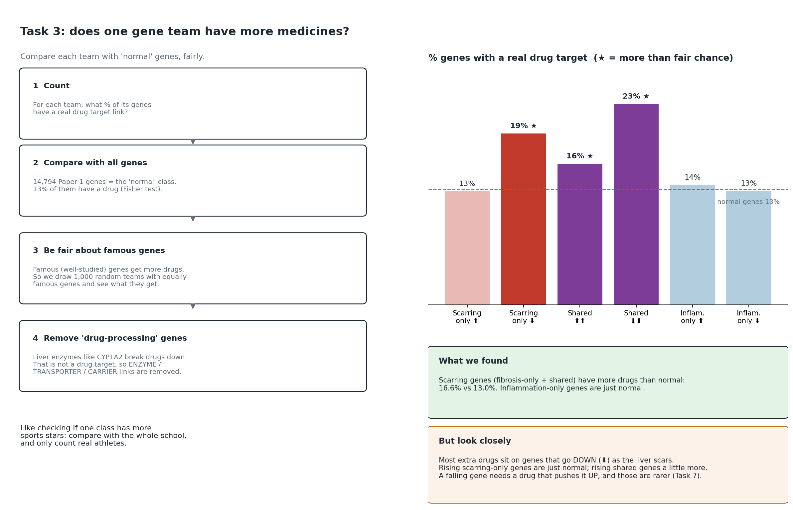
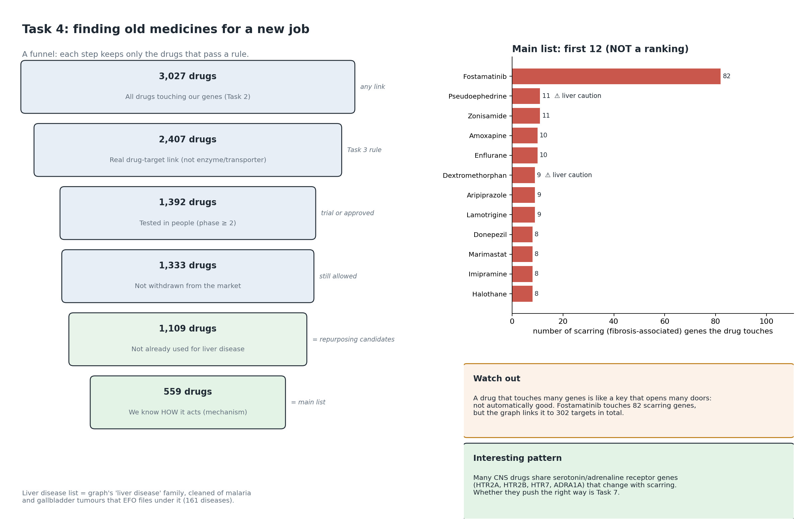
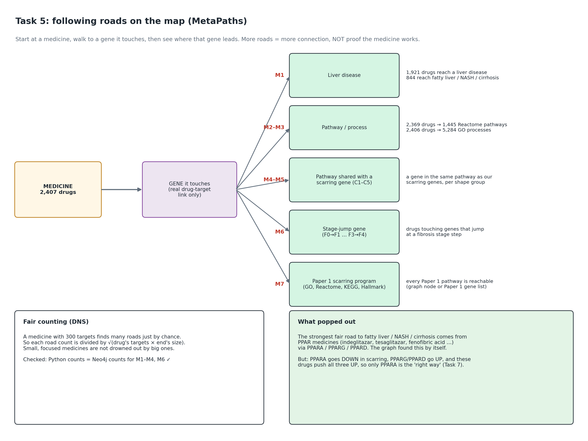
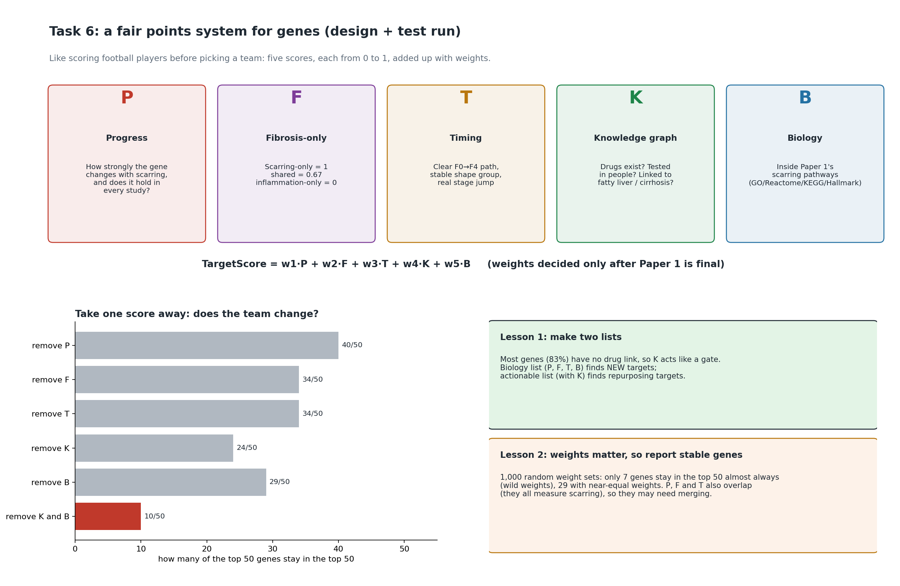
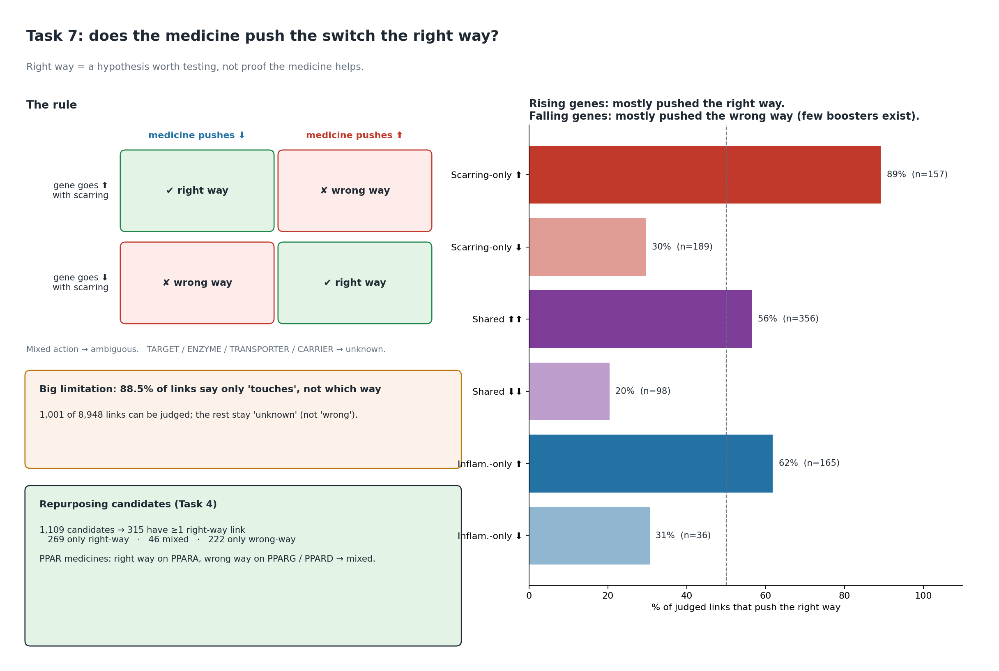
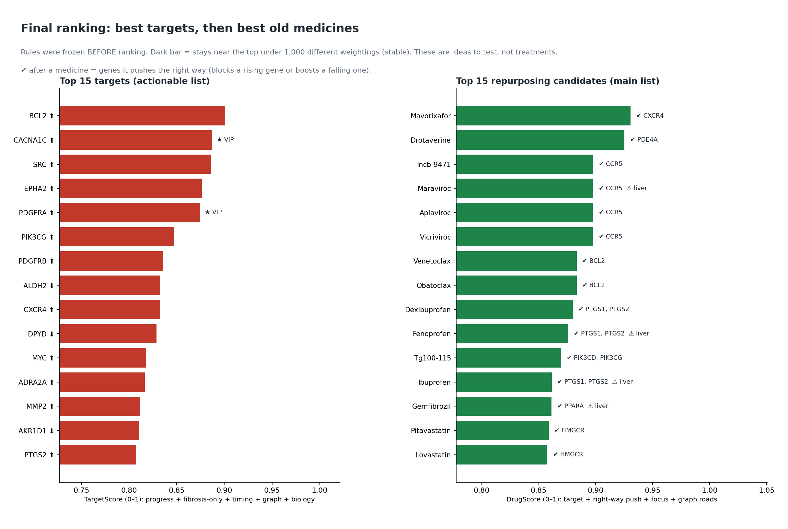

# Paper 2 — report (Tasks 1–8, including the final ranking)

*Liver fibrosis progression: knowledge-graph drug repurposing. Prepared 15 Oct 2026.*

## Scope (project scope decision, 13 Oct 2026)
- **Knowledge-graph-only drug repurposing:** Neo4j `liver_kg` (OptimusKG layer, read-only queries) plus Paper 1 results.
- **Out of scope:** transcriptomic drug-reversal analysis (LINCS/CMap), external databases, and independent external validation.
- All outputs are **repurposing hypotheses / candidate relationships**, not treatments and not evidence of anti-fibrotic efficacy.
- **Gene set:** the plan cites 4,692 progression genes, which was the pre-correction count. Paper 2 uses the **corrected Paper 1 union of 6,222 genes** (final combined version, 10 Oct 2026): fibrosis-only 2,023, shared 1,822, inflammation-only 2,377.

## Executive summary
1. **1,072 / 6,222 progression genes** (17.2%) have ≥1 drug in the graph: 8,948 drug–gene links, 3,027 drugs. Neo4j and the knowledge-layer CSV agree exactly.
2. **Fibrosis-associated genes are over-represented among drug targets** (16.6% vs 13.0% background; 1.30× a degree-matched null), while inflammation-only genes are not. The excess comes mainly from genes that **fall** with fibrosis.
3. **1,109 repurposing candidates** (phase ≥ 2, not withdrawn, no existing liver-disease use); **559** have mechanism annotation (main list); **315** have ≥1 direction-consistent link.
4. **MetaPaths** connect drugs to liver disease, pathways, processes, trajectory clusters, stage transitions and Paper 1 fibrosis programs. Every count was verified inside Neo4j. The strongest fibrosis-spectrum support comes from **PPAR agonists** (INDEGLITAZAR, TESAGLITAZAR, MURAGLITAZAR, GW501516, FENOFIBRIC ACID …), which are direction-**mixed** (consistent on PPARA, inconsistent on PPARG/PPARD).
5. **Only 1,001 of 8,948 links (11.2%) have a known action direction.** Rising fibrosis-only genes are mostly targeted in the consistent direction (89%); falling genes rarely are (30%), because activators are scarce.
6. **Only 84 of 1,109 candidates (7.6%)** act on a gene from the Paper 1 23-gene shortlist; the other 1,025 rely on broad progression evidence only.
7. **Final ranking (Paper 1 final, rules frozen first):** 29 stable actionable targets and 27 stable biology targets; 19 stable drugs in the top 25. The top-ranked repurposing hypotheses include a CXCR4 antagonist (mavorixafor), CCR5 antagonists (maraviroc and others), BCL2 inhibitors (venetoclax, obatoclax), NSAIDs acting on PTGS1/2, statins and fibrates.
8. **Quality:** an independent audit (`AUDIT.md`) re-computes the key numbers with separate code and fresh Neo4j queries: **86/86 checks pass.** All scripts re-run to identical outputs.

---

## Task 1: master progression-gene table
**Done:** `Task1/Paper2_progression_genes.csv` holds all 6,222 genes with fibrosis/inflammation ρ and q, direction, F0–F4 profile, trajectory cluster, membership confidence, largest stage transition, tier and shortlist flag. No gene was dropped.

| Group | Genes |
|---|---|
| fibrosis-only ⬆ / ⬇ | 1,040 / 983 |
| shared ⬆⬆ / ⬇⬇ / discordant | 1,408 / 384 / 30 |
| inflammation-only ⬆ / ⬇ | 2,042 / 335 |

All 11 group counts match Paper 1 Task 1.

## Task 2: drug–gene relationships from the knowledge graph
**Done:** `Task2/drug_gene_edges.csv` contains every `Drug-[:ACTS_ON]->Gene` link for the progression genes, read-only from Neo4j, with source evidence (DrugBank / Open Targets, evidence level, mechanism text, literature URLs, approval and phase).

| Measure | Value |
|---|---|
| Links (Neo4j = CSV, identical triples) | 8,948 = 8,948 |
| Genes with ≥1 drug | 1,072 (17.2%) |
| Unique drugs | 3,027 |
| Known action direction | 1,001 (11.2%) |
| Evidence level single / multi-source | 7,855 / 1,093 |

## Task 3: druggability across progression groups
**Done:** Fisher's exact tests versus the 14,794-gene Paper 1 eligible background (BH-FDR), plus a degree-aware permutation null (1,000 sets matched on network degree). The main definition counts **pharmacological-target links** only, because ENZYME/TRANSPORTER/CARRIER links describe drug metabolism (CYPs, ABC/SLC transporters). Both definitions are reported, and the conclusions agree.

| Group | % drug-target | Fold vs degree-matched | Permutation FDR |
|---|---|---|---|
| Fibrosis-associated | 16.6 | 1.30 | 0.004 |
| fibrosis-only ⬆ | 12.8 | 1.01 | 0.955 |
| fibrosis-only ⬇ | 19.3 | 1.55 | 0.004 |
| shared ⬆⬆ | 15.9 | 1.19 | 0.0137 |
| shared ⬇⬇ | 22.7 | 1.85 | 0.004 |
| inflammation-only | 13.4 | 0.98 | 0.827 |

Background: 13.0%. Fibrosis-only vs inflammation-only: OR 1.23 (FDR 0.028); shared vs inflammation-only: OR 1.35 (FDR 0.00151).

## Task 4: drug coverage and repurposing candidates
**Done:** per-drug coverage of each Paper 1 group and cluster, progression-target fraction (specificity), approval, phase, withdrawal and existing disease uses from the graph. The liver-disease set is EFO "liver disease" plus descendants, **cleaned of 70 non-hepatic entries** (malaria, gallbladder/ampulla tumours, erythropoietic porphyrias), leaving 161 diseases.

| Step | Drugs |
|---|---|
| Pharmacological link to a progression gene | 2,407 |
| Phase ≥ 2 | 1,392 |
| Not withdrawn | 1,333 |
| No existing liver-disease use → **repurposing candidates** | **1,109** |
| Mechanism-annotated → **main list** | **559** |

151 candidates are liver-contraindicated (kept and flagged). Nutrients and cofactors without mechanism (zinc salts, glycine, ATP …) are kept in the full list but separated from the main list. A Cytoscape-ready network of the top 30 main-list candidates is provided. **Candidate generation only; no drug is called the best candidate.**

## Task 5: MetaPaths
**Done:** M1 (Drug→Gene→liver disease), M1f (fibrosis-spectrum diseases), M2 (Reactome), M3 (GO BP), M4/M5 (Drug→Gene→Pathway←progression / cluster genes), M6 (stage-transition genes), M7 (Paper 1 fibrosis-enriched GO/Reactome/KEGG/Hallmark terms, via graph nodes or Paper 1 gene lists). Degree-normalised support = paths / √(drug degree × end-node degree). All queries are in `Task5/metapath_queries.cypher`.

| MetaPath | Paths | Drugs | Candidate drugs |
|---|---|---|---|
| M1 Drug→Gene→LiverDisease | 24,497 | 1,921 | 926 |
| M1f Drug→Gene→FibrosisSpectrumDisease | 3,164 | 844 | 537 |
| M2 Drug→Gene→Pathway | 33,089 | 2,369 | 1,102 |
| M3 Drug→Gene→BioProcess | 131,177 | 2,406 | 1,109 |
| M4 Drug→Gene→Pathway←ProgressionGene | 1,058,939 | 2,394 | 1,105 |
| M6 Drug→F0→F1 transition gene | 926 | 740 | 378 |
| M6 Drug→F1→F2 transition gene | 1,205 | 891 | 437 |
| M6 Drug→F2→F3 transition gene | 1,471 | 845 | 466 |
| M6 Drug→F3→F4 transition gene | 828 | 590 | 360 |
| M5 (5 clusters), M7 (4 databases × link type) | see `Task5/metapath_counts.csv` | | |

Python counts equal Neo4j counts for all 8 cross-checks. Three quality-check subgraphs are in `Task5/examples/`: a PPAR agonist → fibrosis-spectrum diseases, Hallmark EMT, and PDGFRA.

## Task 6: target-prioritisation framework (design and test run)
**Done:** `Task6/target_score_framework.md` defines TargetScore = w1·P + w2·F + w3·T + w4·K + w5·B with every component in [0, 1] and traceable to Paper 1 / Paper 2 columns. It covers normalisation (percentile ranks), structural zeros instead of imputation, and the ablation and Dirichlet weight-sensitivity plans. An equal-weight **design test** (whose weights were later frozen for the final ranking) runs on all 6,222 genes:
- K is zero for 83% of genes, and removing K keeps only 24/50 of the top 50. **Report two lists:** a biology score (P, F, T, B) for novel targets and an actionable score (with K) for repurposing.
- Under Dirichlet α = 1, only 7 genes stay in the top 50 in ≥ 80% of draws (29 at α = 10). Report **stable** targets, not single-weight ranks.
- P, F and T overlap (they all describe fibrosis association). Consider merging them before the weights are frozen.

## Task 7: drug action vs. progression direction
**Done:** each link is classed as direction-consistent (inhibits a rising gene / activates a falling gene), direction-inconsistent, ambiguous or unknown, using knowledge-graph action labels only.

| Consistency | Links |
|---|---|
| direction-consistent | 530 |
| direction-inconsistent | 471 |
| ambiguous | 28 |
| unknown | 7,919 |

| Group | % consistent among judged links |
|---|---|
| fibrosis_only_positive | 89% |
| fibrosis_only_negative | 30% |
| shared_positive | 56% |
| shared_negative | 20% |
| inflammation_only_positive | 62% |
| inflammation_only_negative | 31% |

315 of 1,109 candidates have ≥1 direction-consistent link (269 only consistent, 46 mixed, 222 only inconsistent).

---

## Final target and drug ranking (plan Task 8)
**Paper 1 confirmed final (10 Oct 2026 version).** The ranking rules and equal weights were frozen in `Final_ranking/PREREGISTRATION.md` before any rank was computed; nothing was tuned. Stability = rank under 1,000 near-equal random weightings (Dirichlet α = 10); a target or drug is **stable** if it stays in the top 50 / top 25 in at least 80% of draws.

**Targets.** Two lists: *biology* (P, F, T, B) for new targets and *actionable* (P, F, T, K, B) for repurposing. Stable: 27 biology, 29 actionable. Top 10 actionable targets:

| Rank | Gene | Class | Cluster | TargetScore | Stable | Shortlist |
|---|---|---|---|---|---|---|
| 1 | BCL2 ⬆ | fibrosis_only | C2 | 0.9008 | yes |  |
| 2 | CACNA1C ⬆ | fibrosis_only | C2 | 0.8872 | yes | yes |
| 3 | SRC ⬆ | fibrosis_only | C1 | 0.8858 | yes |  |
| 4 | EPHA2 ⬆ | fibrosis_only | C2 | 0.8763 | yes |  |
| 5 | PDGFRA ⬆ | fibrosis_only | C2 | 0.8744 | yes | yes |
| 6 | PIK3CG ⬆ | fibrosis_only | C1 | 0.8472 | yes |  |
| 7 | PDGFRB ⬆ | shared | C1 | 0.8358 | yes |  |
| 8 | ALDH2 ⬇ | fibrosis_only | C5 | 0.8327 | yes |  |
| 9 | CXCR4 ⬆ | shared | C2 | 0.8326 | yes |  |
| 10 | DPYD ⬇ | fibrosis_only | C5 | 0.8289 | yes |  |

**Drugs.** DrugScore = mean of D1 target relevance (best biology TargetScore among the drug's targets), D2 direction-consistency (Task 7), D3 specificity (progression-target fraction) and D4 knowledge-graph support (Task 5). Ranked among the 559 mechanism-annotated candidates; 19 are stable in the top 25. Top 15:

| Rank | Drug | Phase | DrugScore | Stable | Right-way targets | Liver flag |
|---|---|---|---|---|---|---|
| 1 | MAVORIXAFOR | 3 | 0.9306 | yes | CXCR4 |  |
| 2 | DROTAVERINE | 3 | 0.9253 | yes | PDE4A |  |
| 3 | INCB-9471 | 2 | 0.8976 | yes | CCR5 |  |
| 3 | MARAVIROC | 4 | 0.8976 | yes | CCR5 | contraindicated |
| 3 | APLAVIROC | 3 | 0.8976 | yes | CCR5 |  |
| 3 | VICRIVIROC | 3 | 0.8976 | yes | CCR5 |  |
| 7 | VENETOCLAX | 4 | 0.8833 | yes | BCL2 |  |
| 7 | OBATOCLAX | 3 | 0.8833 | yes | BCL2 |  |
| 9 | DEXIBUPROFEN | 4 | 0.8799 | yes | PTGS1;PTGS2 |  |
| 10 | FENOPROFEN | 4 | 0.8758 | yes | PTGS1;PTGS2 | contraindicated |
| 11 | TG100-115 | 2 | 0.8696 | yes | PIK3CD;PIK3CG |  |
| 12 | IBUPROFEN | 4 | 0.8614 | yes | PTGS1;PTGS2 | contraindicated |
| 13 | GEMFIBROZIL | 4 | 0.8613 | yes | PPARA | contraindicated |
| 14 | PITAVASTATIN | 4 | 0.8589 | yes | HMGCR |  |
| 15 | LOVASTATIN | 4 | 0.8576 | yes | HMGCR |  |

Shortlist-supported drugs in the top 25: 2; broad-evidence-only: 23. Ablation: dropping D4 (graph support) changes the top 25 the most (top-25 overlap 9/25), and dropping D2 (direction) changes overall order the most (Spearman 0.73). Evidence cards (which layers support, contradict or are missing for each of the top 25) are in `Final_ranking/evidence_cards_top25.csv` and `Final_ranking/summary.md`.

## Shortlist-supported vs. broad-evidence-only candidates
| Candidate set | Total | Supported by 23-gene shortlist | Broad progression evidence only | % shortlist-supported |
|---|---|---|---|---|
| All repurposing candidates | 1,109 | 84 | 1,025 | 7.6 |
| Main list (mechanism-annotated) | 559 | 46 | 513 | 8.2 |
| With ≥1 direction-consistent link | 315 | 20 | 295 | 6.3 |

Shortlist genes reached by candidates (13 of 23):

| Gene | direction | candidate_drugs | direction_consistent |
|---|---|---|---|
| CACNA1C | rises (positive) | 31 | 17 |
| HTR7 | rises (positive) | 30 | 1 |
| F2 | falls (negative) | 7 | 0 |
| PDGFRA | rises (positive) | 4 | 2 |
| MME | falls (negative) | 4 | 0 |
| LYZ | rises (positive) | 2 | 0 |
| ACADSB | falls (negative) | 2 | 0 |
| KNG1 | falls (negative) | 2 | 0 |
| EPHA3 | rises (positive) | 1 | 0 |
| OAT | falls (negative) | 1 | 0 |
| PLK3 | rises (positive) | 1 | 0 |
| SULT1E1 | falls (negative) | 1 | 0 |
| TYMS | rises (positive) | 1 | 0 |

Most shortlist-supported candidates come from two rising genes, **CACNA1C** (calcium channel) and **HTR7** (serotonin receptor). CACNA1C has 17 direction-consistent links (blockers of a rising gene), whereas HTR7 links are mostly "target" with unknown direction (1 consistent of 30).

## Limitations
1. **88.5% of drug–gene links have unknown action direction** (TARGET/ENZYME/TRANSPORTER/CARRIER). Direction-consistency can only be judged for 1,001 links, and unknown is not the same as inconsistent.
2. **No affinity or potency values** in the graph, so drug strength cannot be weighted.
3. **No per-assertion accession IDs.** Links are identified by ChEMBL drug ID | Ensembl gene ID with source names and, where available, literature URLs.
4. **Knowledge-graph study bias:** well-studied (high-degree) genes have more known drugs (background druggability rises from 5.8% to 23.8% across degree bins). This is addressed with degree-matched nulls and degree-normalised MetaPath support, but not removed.
5. **Graph housekeeping (does not affect results):** in the live Neo4j graph the `fibrosis_rho` property stored on Gene nodes is from the pre-correction Paper 1 run (3,645 genes; missing for 391 current fibrosis genes). The `TRACKS_FIBROSIS` edges are current and match the corrected Paper 1 table exactly. Paper 2 uses only the corrected tables and edges, but the node property should be refreshed by the Paper 1 team.
6. "No liver indication" means none is recorded in the graph, not necessarily none in practice. EFO filed some non-hepatic diseases under "liver disease"; the cleaning rule is documented.
7. Target-score weights were frozen as equal weights for the final ranking (`Final_ranking/PREREGISTRATION.md`); Task 6 keeps the design test that motivated the two-list, stable-target reporting.
8. Scope limits by design: no transcriptomic reversal, no external validation.

## Next steps
1. **Done:** final target and drug ranking with frozen rules, stability and ablation analyses, and evidence cards (section above). Shortlist-supported (84) and broad-evidence-only (1,025) candidates are reported separately.
2. **Safety and literature review** of the stable top candidates, starting with those flagged as liver-contraindicated in the graph, before any experimental follow-up.
3. **Experimental or clinical validation** of selected hypotheses is outside this knowledge-graph study (project scope decision) and would be the next project.
4. Decisions to confirm: (a) accept the pharmacological-target definition (Task 3), (b) accept the cleaned liver-disease set (Task 4), (c) main list = mechanism-annotated candidates, (d) the two-list target-score reporting.

## Files and reproducibility
Every task folder has `summary.md`, a diagram and CSV outputs; scripts are in `Paper2_Results/code/`. Re-check everything with `python Paper2_Results/code/audit_tasks.py`. Guide and prompts: `PAPER2_GUIDE.md`.
