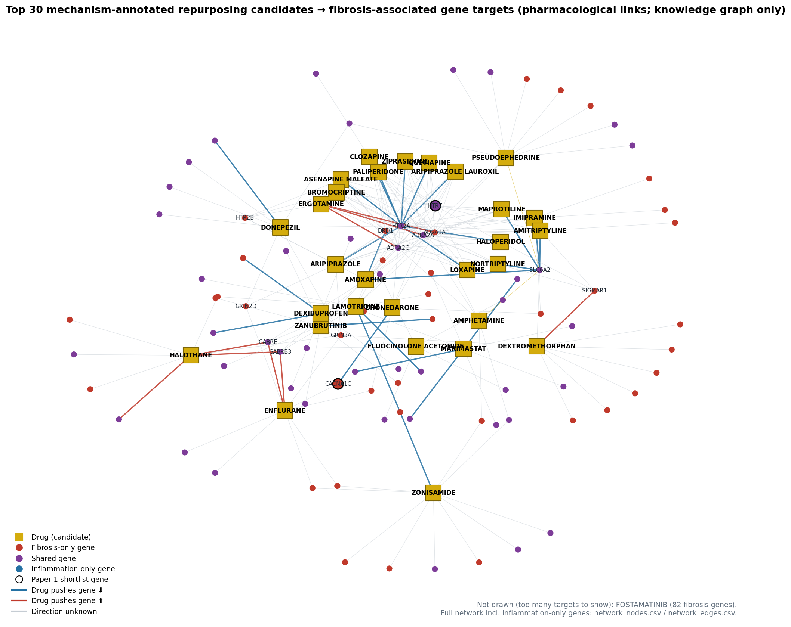

# Paper 2 — Task 4: drug coverage and repurposing candidates

**Gene set note:** the plan refers to 4,692 genes (pre-correction). This uses the corrected Paper 1 union of **6,222 genes**.
**Scope:** knowledge graph only (project scope decision: repurposing, not reversal). Main analysis uses **pharmacological-target links** (ENZYME/TRANSPORTER/CARRIER removed, Task 3); any-link gene counts are in `n_progression_genes_any_link`.
Script: `Paper2_Results/code/task4_drug_coverage.py`.

**This is candidate generation only.** Coverage is not a therapeutic score. Broad, heavily annotated drugs (e.g. multi-kinase inhibitors) touch many genes, so `progression_target_fraction` (progression targets / all pharmacological targets in the graph) is reported alongside coverage. No drug here is "the best candidate".

## From drugs to repurposing candidates

| Step | Drugs |
|---|---|
| Drugs with ≥1 pharmacological link to a progression gene | 2407 |
| …with max_phase ≥ 2 | 1392 |
| …and not withdrawn | 1333 |
| …and no existing liver-disease TREATS/OFF_LABEL_FOR use → **repurposing candidates** | 1109 |
| …of which mechanism-annotated (≥1 link with known action or mechanism text) → **main list** | 559 |

- Liver disease = `EFO_0001421` "liver disease" + all `PARENT_OF` descendants, **minus 70 non-hepatic-tissue entries** that EFO files under it (malaria, gallbladder / ampulla / extrahepatic bile-duct tumours, erythropoietic porphyrias) = **161 liver diseases**. Both kept and removed entries are listed in `liver_disease_set.csv`. Without this step, antimalarials such as those for *Plasmodium* malaria would be wrongly treated as existing liver drugs.
- 227 drugs hitting progression genes **already** have a liver-disease TREATS/OFF_LABEL_FOR use. These are excluded from candidates (they are not repurposing) but stay in `drug_coverage.csv` as a reference set.
- 151 candidates are **contraindicated** in a liver disease. They are kept and flagged (`liver_contraindicated`), as requested.
- 84 candidates hit at least one gene in the Paper 1 23-gene shortlist.

## Main list: top 20 mechanism-annotated repurposing candidates

Ordered by fibrosis-gene coverage, then progression-target fraction. "Mechanism-annotated" means the graph says *how* the drug acts on at least one of its progression-gene targets (inhibitor, agonist, … or a mechanism-of-action text). These are the interpretable candidates.

| mechanism_order | Drug | phase | n_fibrosis_genes | n_progression_genes | pharm_targets_graph | frac | n_down_actions | n_up_actions | shortlist_targets | liver CI | now used for |
|---|---|---|---|---|---|---|---|---|---|---|---|
| 1 | FOSTAMATINIB | 4 | 82 | 131 | 302 | 0.43 | 1 | 0 | EPHA3;PDGFRA;PLK3 |  | Anemia, Hemolytic, Autoimmune; COVID-19; IGA glomerulonephritis |
| 2 | PSEUDOEPHEDRINE | 4 | 11 | 12 | 19 | 0.63 | 0 | 0 |  | ⚠️ yes | Rhinitis, Allergic, Perennial; allergic conjunctivitis; allergic disease |
| 3 | ZONISAMIDE | 4 | 11 | 13 | 31 | 0.42 | 2 | 0 |  |  | Lewy body dementia; Parkinson disease; alcohol abuse |
| 4 | AMOXAPINE | 4 | 10 | 12 | 44 | 0.27 | 3 | 0 | HTR7 |  | depressive disorder; major depressive disorder |
| 5 | ENFLURANE | 4 | 10 | 12 | 52 | 0.23 | 0 | 2 | CACNA1C |  |  |
| 6 | DEXTROMETHORPHAN | 4 | 9 | 10 | 21 | 0.48 | 0 | 1 |  | ⚠️ yes | Alzheimer disease; Crohn's disease; HIV infection |
| 7 | ARIPIPRAZOLE | 4 | 9 | 12 | 44 | 0.27 | 1 | 0 | HTR7 |  | Asperger syndrome; Tourette syndrome; aggressive behavior |
| 8 | LAMOTRIGINE | 4 | 9 | 10 | 41 | 0.24 | 3 | 0 |  |  | Fish-eye disease; HIV infection; Lennox-Gastaut syndrome |
| 9 | DONEPEZIL | 4 | 8 | 8 | 15 | 0.53 | 1 | 0 |  |  | Alzheimer disease; Central Nervous System Neoplasm; Classical progressive supranuclear palsy |
| 10 | MARIMASTAT | 3 | 8 | 10 | 23 | 0.43 | 3 | 0 |  |  | breast cancer; lung cancer |
| 11 | IMIPRAMINE | 4 | 8 | 9 | 25 | 0.36 | 1 | 0 | HTR7 |  | actinic keratosis; anxiety; breast cancer |
| 12 | HALOTHANE | 4 | 8 | 9 | 34 | 0.27 | 0 | 3 |  |  |  |
| 13 | ZANUBRUTINIB | 4 | 7 | 10 | 15 | 0.67 | 1 | 0 |  |  | Anemia, Hemolytic, Autoimmune; COVID-19; Castleman disease |
| 14 | ASENAPINE MALEATE | 4 | 7 | 9 | 20 | 0.45 | 1 | 0 | HTR7 | ⚠️ yes | bipolar I disorder; bipolar disorder; psychosis |
| 15 | BROMOCRIPTINE | 4 | 7 | 8 | 18 | 0.44 | 0 | 1 | HTR7 |  | Adenomyosis; Alzheimer disease; Parkinson disease |
| 16 | HALOPERIDOL | 4 | 7 | 7 | 18 | 0.39 | 1 | 0 | HTR7 |  | Alzheimer disease; Huntington disease; Tourette syndrome |
| 17 | DRONEDARONE | 4 | 7 | 9 | 27 | 0.33 | 1 | 0 | CACNA1C | ⚠️ yes | atrial fibrillation; atrial flutter; cardiac arrhythmia |
| 18 | CLOZAPINE | 4 | 7 | 9 | 27 | 0.33 | 1 | 0 | HTR7 |  | anxiety; bipolar disorder; depressive disorder |
| 19 | LOXAPINE | 4 | 7 | 10 | 32 | 0.31 | 2 | 0 | HTR7 |  | anxiety; asthma; bipolar I disorder |
| 20 | AMITRIPTYLINE | 4 | 7 | 9 | 33 | 0.27 | 1 | 0 | HTR7 |  | Intervertebral Disc Displacement; anxiety; biliary dyskinesia |

Full list: `repurposing_candidates_mechanism_annotated.csv` (559 drugs).

## All candidates, including drugs with no mechanism annotation

The all-candidate ordering is dominated by **nutrients, metal ions and cofactors** (zinc salts, glutamic acid, pyridoxal phosphate, ATP, glycine, calcium salts). DrugBank lists many enzymes that *bind* them as "TARGET", with no action or mechanism. They are kept for completeness but are not meaningful repurposing hypotheses without mechanism evidence.

| candidate_order | Drug | phase | n_fibrosis_genes | fib_only_pos | fib_only_neg | shared_pos | shared_neg | n_progression_genes | pharm_targets_graph | frac | n_down_actions | n_up_actions | shortlist_targets | liver CI |
|---|---|---|---|---|---|---|---|---|---|---|---|---|---|---|
| 1 | FOSTAMATINIB | 4 | 82 | 30 | 17 | 30 | 5 | 131 | 302 | 0.43 | 1 | 0 | EPHA3;PDGFRA;PLK3 |  |
| 2 | ZINC ACETATE ANHYDROUS | 4 | 39 | 2 | 23 | 6 | 7 | 49 | 124 | 0.40 | 0 | 0 | F2;KNG1 |  |
| 3 | ZINC CHLORIDE | 4 | 31 | 2 | 18 | 5 | 5 | 41 | 97 | 0.42 | 0 | 0 | KNG1 |  |
| 4 | GLUTAMIC ACID | 3 | 22 | 2 | 10 | 4 | 6 | 33 | 61 | 0.54 | 0 | 0 |  |  |
| 5 | PYRIDOXAL PHOSPHATE ANHYDROUS | 3 | 20 | 1 | 9 | 2 | 8 | 23 | 49 | 0.47 | 0 | 0 | OAT |  |
| 6 | ADENOSINE TRIPHOSPHATE | 2 | 16 | 5 | 6 | 3 | 2 | 21 | 42 | 0.50 | 0 | 0 |  |  |
| 7 | GLYCINE | 4 | 12 | 1 | 4 | 0 | 7 | 14 | 24 | 0.58 | 0 | 0 |  |  |
| 8 | PSEUDOEPHEDRINE | 4 | 11 | 2 | 2 | 7 | 0 | 12 | 19 | 0.63 | 0 | 0 |  | ⚠️ yes |
| 9 | PROCAINE | 4 | 11 | 2 | 4 | 2 | 3 | 12 | 19 | 0.63 | 0 | 0 |  |  |
| 10 | ZONISAMIDE | 4 | 11 | 3 | 4 | 1 | 3 | 13 | 31 | 0.42 | 2 | 0 |  |  |
| 11 | GLUTATHIONE | 3 | 10 | 1 | 4 | 5 | 0 | 13 | 37 | 0.35 | 0 | 0 |  |  |
| 12 | AMOXAPINE | 4 | 10 | 1 | 2 | 6 | 1 | 12 | 44 | 0.27 | 3 | 0 | HTR7 |  |
| 13 | ENFLURANE | 4 | 10 | 4 | 2 | 4 | 0 | 12 | 52 | 0.23 | 0 | 2 | CACNA1C |  |
| 14 | DEXTROMETHORPHAN | 4 | 9 | 4 | 4 | 1 | 0 | 10 | 21 | 0.48 | 0 | 1 |  | ⚠️ yes |
| 15 | CALCIUM CITRATE | 4 | 9 | 4 | 2 | 2 | 1 | 15 | 32 | 0.47 | 0 | 0 |  |  |
| 16 | CALCIUM PHOSPHATE, TRIBASIC | 2 | 9 | 4 | 2 | 2 | 1 | 15 | 32 | 0.47 | 0 | 0 |  |  |
| 17 | PRASTERONE | 4 | 9 | 1 | 4 | 2 | 2 | 9 | 30 | 0.30 | 0 | 0 |  |  |
| 18 | ARIPIPRAZOLE | 4 | 9 | 2 | 3 | 3 | 1 | 12 | 44 | 0.27 | 1 | 0 | HTR7 |  |
| 19 | LAMOTRIGINE | 4 | 9 | 1 | 2 | 4 | 2 | 10 | 41 | 0.24 | 3 | 0 |  |  |
| 20 | DONEPEZIL | 4 | 8 | 1 | 1 | 4 | 2 | 8 | 15 | 0.53 | 1 | 0 |  |  |

Full list: `repurposing_candidates.csv` (1,109 drugs, with current indications, target genes, cluster counts and action counts).

## Top 15 drugs by raw progression-gene coverage (all drugs, incl. existing liver drugs)

| Drug | max_phase | n_progression_genes | n_fibrosis_genes | inflammation_only_targets | pharm_targets_graph | frac | liver use |
|---|---|---|---|---|---|---|---|
| FOSTAMATINIB | 4.0 | 131 | 82 | 49 | 302 | 0.43 |  |
| CHEMBL1201279 |  | 50 | 40 | 10 | 125 | 0.40 |  |
| ZINC ACETATE ANHYDROUS | 4.0 | 49 | 39 | 10 | 124 | 0.40 |  |
| ZINC CHLORIDE | 4.0 | 41 | 31 | 10 | 97 | 0.42 |  |
| GLUTAMIC ACID | 3.0 | 33 | 22 | 11 | 61 | 0.54 |  |
| CANNABIDIOL | 4.0 | 26 | 17 | 9 | 41 | 0.63 | yes |
| NABIXIMOLS | 3.0 | 26 | 16 | 10 | 41 | 0.63 | yes |
| PHENETHYLISOTHIOCYANATE |  | 26 | 14 | 12 | 44 | 0.59 |  |
| PYRIDOXAL PHOSPHATE ANHYDROUS | 3.0 | 23 | 20 | 3 | 49 | 0.47 |  |
| ADENOSINE TRIPHOSPHATE | 2.0 | 21 | 16 | 5 | 42 | 0.50 |  |
| CHEMBL384759 |  | 21 | 5 | 16 | 36 | 0.58 |  |
| SODIUM beta-NICOTINAMIDE ADENINE DINUCLEOTIDE PHOSPHATE |  | 19 | 12 | 7 | 30 | 0.63 |  |
| FLAVIN ADENIN DINUCLEOTIDE | -1.0 | 18 | 11 | 7 | 25 | 0.72 |  |
| ASPIRIN | 4.0 | 17 | 11 | 6 | 28 | 0.61 | yes |
| CALCIUM CITRATE | 4.0 | 15 | 9 | 6 | 32 | 0.47 |  |

Full top 50: `top50_by_coverage.csv`.

## Drugs that already have a liver-disease use (reference, not candidates)

| Drug | max_phase | n_fibrosis_genes | n_progression_genes | liver_indications |
|---|---|---|---|---|
| CANNABIDIOL | 4.0 | 17 | 26 | Autoimmune Hepatitis |
| NABIXIMOLS | 3.0 | 16 | 26 | liver disease |
| ASPIRIN | 4.0 | 11 | 17 | alcoholic liver disease; hepatocellular carcinoma |
| CAFFEINE | 4.0 | 11 | 13 | chronic hepatitis C virus infection; liver disease; non-alcoholic steatohepatitis |
| SPIRONOLACTONE | 4.0 | 10 | 14 | cirrhosis of liver; non-alcoholic steatohepatitis |
| DASATINIB | 4.0 | 10 | 13 | cholangiocarcinoma; hepatocellular carcinoma |
| RESVERATROL | 3.0 | 9 | 11 | liver cancer; non-alcoholic fatty liver disease |
| ALCOHOL | 4.0 | 9 | 10 | cirrhosis of liver |
| MINOCYCLINE | 4.0 | 8 | 14 | sclerosing cholangitis |
| REGORAFENIB | 4.0 | 8 | 10 | bile duct carcinoma; biliary tract cancer; cholangiocarcinoma; hepatocellular carcinoma; intrahepatic cholangiocarcinoma |

## Network
`network_nodes.csv` / `network_edges.csv` (Cytoscape-ready): top 30 candidates → their progression-gene targets (223 genes, 390 links). Gene attributes: class, direction, trajectory cluster, main Paper 1 pathway (Hallmark > Reactome > KEGG > GO, most significant), shortlist flag. Drug attribute: is_approved. Edge attribute: action direction.

## Caveats
- Coverage counts known drug–target annotations, which favour well-studied drugs and genes.
- Most links have unknown push direction (Task 2). Whether a candidate's action opposes the fibrosis direction is checked in Task 7.
- "No liver indication in the graph" means none is recorded in OptimusKG, not necessarily none in practice.
- Candidates are **repurposing hypotheses**, not treatments.
