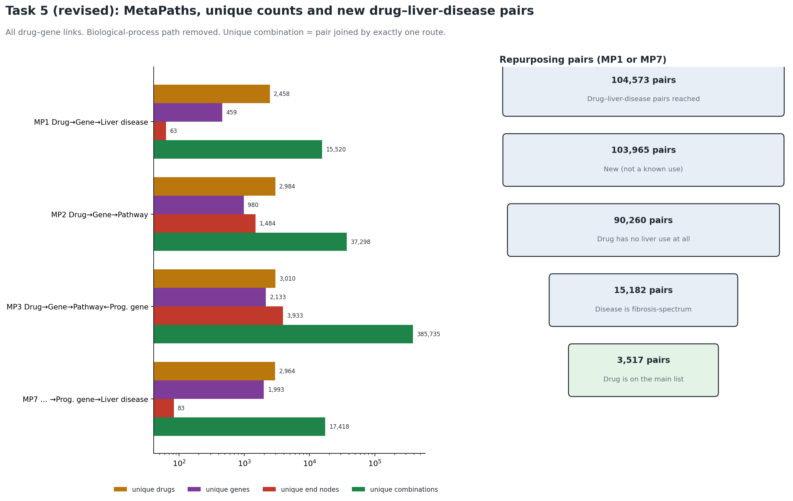
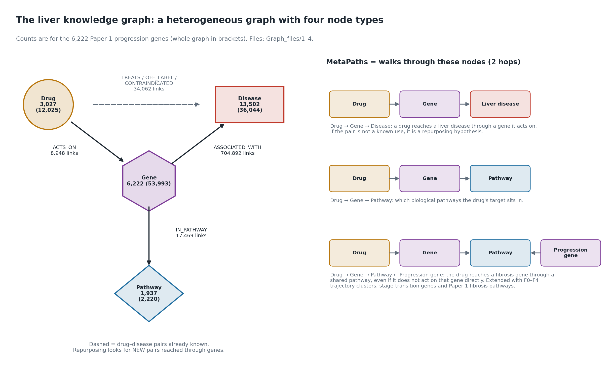

# Paper 2 — Task 5 (revised): MetaPaths on the knowledge graph

**Gene set:** corrected Paper 1 union of 6,222 progression genes (earlier plans cite 4,692, the pre-correction count).
**Scope:** knowledge graph only (live Neo4j, read-only). Repurposing hypotheses, not treatments.
**Changes from the first Task 5:** the Drug → Gene → Biological Process MetaPath is removed (GO BP terms too); unique counts and unique combinations are added; the full repurposing route MP7 is added; ALL drug–gene links are used (pharmacological-only counts beside them). Script: `code/task5_revised_metapaths.py`.

## Definitions
| MetaPath | Pattern | End nodes | Unique combination |
|---|---|---|---|
| MP1 | Drug -[ACTS_ON]-> Gene (progression) -[ASSOCIATED_WITH]-> Disease | 161 liver diseases (MP1f: fibrosis-spectrum subset) | a drug–end pair joined by exactly one route (one gene, or one gene–pathway–gene chain) |
| MP2 | Drug -[ACTS_ON]-> Gene (progression) -[IN_PATHWAY]-> Pathway | Reactome pathways | a drug–end pair joined by exactly one route (one gene, or one gene–pathway–gene chain) |
| MP3 | Drug -[ACTS_ON]-> Gene -[IN_PATHWAY]-> Pathway <-[IN_PATHWAY]- Progression gene (different gene) | progression genes | a drug–end pair joined by exactly one route (one gene, or one gene–pathway–gene chain) |
| MP4 | MP3 with the end gene in one F0–F4 trajectory cluster | Paper 1 clusters C1–C5 | a drug–end pair joined by exactly one route (one gene, or one gene–pathway–gene chain) |
| MP5 | MP3 with the end gene significant at one stage transition (q < 0.05) | Paper 1 Task 3 transitions | a drug–end pair joined by exactly one route (one gene, or one gene–pathway–gene chain) |
| MP6 | Drug -[ACTS_ON]-> Gene ∈ Paper 1 fibrosis-enriched pathway | Reactome (graph node), KEGG and Hallmark (Paper 1 gene lists); GO BP omitted | a drug–end pair joined by exactly one route (one gene, or one gene–pathway–gene chain) |
| MP7 | Drug -[ACTS_ON]-> Gene -[IN_PATHWAY]-> Pathway <-[IN_PATHWAY]- Progression gene -[ASSOCIATED_WITH]-> Liver disease | 161 liver diseases | a drug–end pair joined by exactly one route (one gene, or one gene–pathway–gene chain) |

## Counts (all drug–gene links)
| MetaPath | paths | unique drugs | unique genes | unique end nodes | drug–end pairs | unique combinations (pairs with exactly one route) | unique pathways |
|---|---|---|---|---|---|---|---|
| MP1 Drug→Gene→LiverDisease | 37,615 | 2,458 | 459 | 63 | 22,662 | 15,520 |  |
| MP1f Drug→Gene→FibrosisSpectrumDisease | 4,008 | 1,108 | 85 | 10 | 3,056 | 2,431 |  |
| MP2 Drug→Gene→Pathway | 52,514 | 2,984 | 980 | 1,484 | 43,357 | 37,298 | 1,484 |
| MP3 Drug→Gene→Pathway←ProgressionGene | 1,530,593 | 3,010 | 2,133 | 3,933 | 661,214 | 385,735 | 1,587 |
| MP4 Drug→Gene→Pathway←C1 gene | 230,883 | 2,819 | 1,696 | 565 | 110,187 | 69,227 | 963 |
| MP4 Drug→Gene→Pathway←C2 gene | 328,788 | 2,879 | 1,826 | 822 | 149,335 | 87,819 | 1,021 |
| MP4 Drug→Gene→Pathway←C3 gene | 51,402 | 2,547 | 1,217 | 149 | 22,469 | 13,885 | 342 |
| MP4 Drug→Gene→Pathway←C4 gene | 93,579 | 2,695 | 1,584 | 253 | 39,408 | 22,268 | 680 |
| MP4 Drug→Gene→Pathway←C5 gene | 281,236 | 2,932 | 1,946 | 626 | 107,513 | 57,134 | 857 |
| MP5 Drug→Gene→Pathway←F0→F1 transition gene | 234,747 | 2,898 | 1,764 | 568 | 111,542 | 69,296 | 914 |
| MP5 Drug→Gene→Pathway←F1→F2 transition gene | 336,356 | 2,941 | 1,967 | 711 | 140,621 | 79,923 | 1,066 |
| MP5 Drug→Gene→Pathway←F2→F3 transition gene | 290,926 | 2,913 | 1,885 | 710 | 124,755 | 71,794 | 973 |
| MP5 Drug→Gene→Pathway←F3→F4 transition gene | 219,224 | 2,861 | 1,715 | 476 | 96,402 | 57,088 | 781 |
| MP6 Drug→Gene→Paper1 fibrosis pathway [Reactome] | 31,345 | 2,648 | 1,003 | 189 | 19,239 | 13,422 | 189 |
| MP6 Drug→Gene→Paper1 fibrosis pathway [KEGG] | 10,763 | 1,562 | 270 | 91 | 7,796 | 5,923 | 91 |
| MP6 Drug→Gene→Paper1 fibrosis pathway [Hallmark] | 4,247 | 1,730 | 289 | 36 | 3,799 | 3,457 | 36 |
| MP7 Drug→Gene→Pathway←ProgressionGene→LiverDisease | 5,216,164 | 2,964 | 1,993 | 83 | 104,008 | 17,418 | 1,399 |

**Unique combination** = a drug–end pair connected by exactly one route.

## All links vs pharmacological links only
| MetaPath | paths (all links) | paths (pharmacological only) |
|---|---|---|
| MP1 Drug→Gene→LiverDisease | 37,615 | 24,497 |
| MP1f Drug→Gene→FibrosisSpectrumDisease | 4,008 | 3,164 |
| MP2 Drug→Gene→Pathway | 52,514 | 33,089 |
| MP3 Drug→Gene→Pathway←ProgressionGene | 1,530,593 | 1,100,522 |
| MP4 Drug→Gene→Pathway←C1 gene | 230,883 | 190,897 |
| MP4 Drug→Gene→Pathway←C2 gene | 328,788 | 259,541 |
| MP4 Drug→Gene→Pathway←C3 gene | 51,402 | 45,536 |
| MP4 Drug→Gene→Pathway←C4 gene | 93,579 | 64,945 |
| MP4 Drug→Gene→Pathway←C5 gene | 281,236 | 126,191 |
| MP5 Drug→Gene→Pathway←F0→F1 transition gene | 234,747 | 185,388 |
| MP5 Drug→Gene→Pathway←F1→F2 transition gene | 336,356 | 192,014 |
| MP5 Drug→Gene→Pathway←F2→F3 transition gene | 290,926 | 207,276 |
| MP5 Drug→Gene→Pathway←F3→F4 transition gene | 219,224 | 161,403 |
| MP6 Drug→Gene→Paper1 fibrosis pathway [Reactome] | 31,345 | 12,520 |
| MP6 Drug→Gene→Paper1 fibrosis pathway [KEGG] | 10,763 | 4,505 |
| MP6 Drug→Gene→Paper1 fibrosis pathway [Hallmark] | 4,247 | 2,694 |
| MP7 Drug→Gene→Pathway←ProgressionGene→LiverDisease | 5,216,164 | 4,179,412 |

## Repurposing pairs: drug → liver disease through genes
Drug–liver-disease pairs reached by MP1 (through a gene the drug acts on) or MP7 (through a pathway shared with a progression gene associated with the disease): **104,573 pairs**. Of these, **608** are already known uses in the graph (TREATS / OFF_LABEL_FOR) and **103,965 are NEW pairs**. Of the new pairs, **90,260** come from drugs with **no liver-disease use at all** in the graph (true repurposing), 15,182 of them for fibrosis-spectrum diseases (fatty liver, NASH, cirrhosis, liver failure …). 21,400 of these true-repurposing pairs involve main-list (mechanism-annotated) candidate drugs, 3,517 of them for fibrosis-spectrum diseases. 176 new pairs are flagged as contraindicated.

| Pair set | Pairs |
|---|---|
| All drug–liver-disease pairs reached (MP1 or MP7) | 104,573 |
| Known uses (TREATS / OFF_LABEL_FOR) | 608 |
| New pairs | 103,965 |
| New pairs, drug has no liver use at all | 90,260 |
| … and disease is fibrosis-spectrum | 15,182 |
| … and drug is on the main list | 3,517 |
| New pairs reached by exactly one MP1 route (unique combination) | 15,350 |

### New fibrosis-spectrum pairs from main-list drugs with no liver use (most direct MP1 routes)
| drug_name | disease_name | MP1_paths | MP1_genes | MP7_paths | contraindicated |
|---|---|---|---|---|---|
| FOSTAMATINIB | non-alcoholic fatty liver disease | 5 | DCLK2;MAP3K1;MTOR;PRKAA1;PRKAA2 | 982 |  |
| FOSTAMATINIB | fatty liver disease | 5 | DCLK2;MAP3K1;MTOR;PRKAA1;PRKAA2 | 982 |  |
| ARIPIPRAZOLE | cirrhosis of liver | 5 | ADRA2A;ADRA2C;GRIN2D;GRIN3A;HTR2A | 239 |  |
| ENFLURANE | cirrhosis of liver | 5 | CACNA2D1;GABRB3;GABRE;GRIN2D;GRIN3A | 128 |  |
| AMOXAPINE | cirrhosis of liver | 5 | ADRA2A;ADRA2C;GABRB3;GABRE;HTR2A | 116 |  |
| INAMRINONE | non-alcoholic fatty liver disease | 5 | PDE3A;PDE3B;PDE4A;PDE4D;TNF | 52 |  |
| INAMRINONE | fatty liver disease | 5 | PDE3A;PDE3B;PDE4A;PDE4D;TNF | 52 |  |
| INAMRINONE | non-alcoholic steatohepatitis | 5 | PDE3A;PDE3B;PDE4A;PDE4D;TNF | 44 |  |
| INAMRINONE | cirrhosis of liver | 5 | PDE3A;PDE3B;PDE4A;PDE4D;TNF | 39 |  |
| EPOTHILONE D | cirrhosis of liver | 4 | TUBB1;TUBB3;TUBB4A;TUBB4B | 1,939 |  |
| EPOTHILONE D | biliary liver cirrhosis | 4 | TUBB1;TUBB3;TUBB4A;TUBB4B | 1,889 |  |
| EPOTHILONE D | primary biliary cirrhosis | 4 | TUBB1;TUBB3;TUBB4A;TUBB4B | 1,889 |  |
| EPOTHILONE D | cirrhosis, familial | 4 | TUBB1;TUBB3;TUBB4A;TUBB4B | 1,889 |  |
| DONEPEZIL | cirrhosis of liver | 4 | GRIN2D;GRIN3A;HTR2A;NFKB1 | 129 |  |
| ACAMPROSATE | cirrhosis of liver | 4 | GABRB3;GABRE;GRIN2D;GRIN3A | 108 |  |

Full list: `drug_liver_disease_pairs.csv`.

## Verification
MP1, MP2 and MP3 path counts were re-counted inside Neo4j: MP1 37,615 = 37,615, MP2 52,514 = 52,514, MP3 1,530,593 = 1,530,593 (all match). LIMIT 5 test query for MP7 run first. All queries: `metapath_queries.cypher`.

## Caveats
- More routes mean more graph connectivity, not efficacy. Well-studied drugs and genes have more routes.
- Gene–disease links are Open Targets associations (score ≥ 0.1), many from cancer studies.
- KEGG and Hallmark pathways reach drugs only through their Paper 1 progression genes (no graph node).
