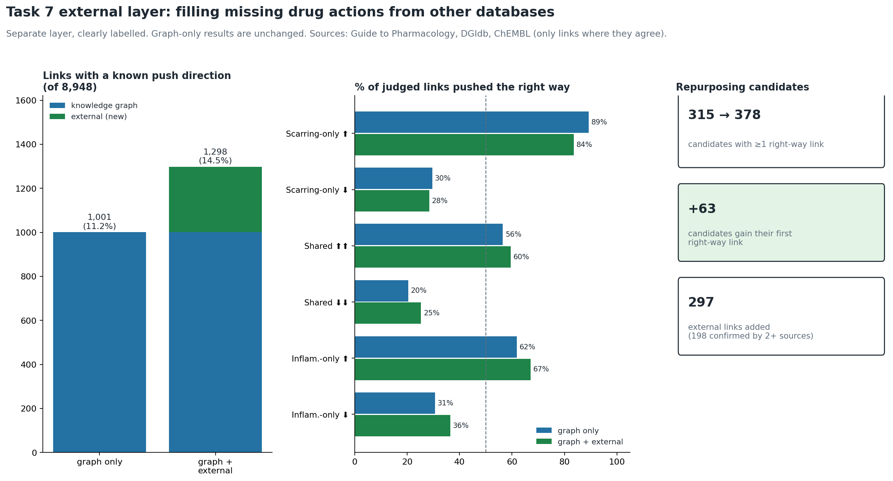

# Paper 2 — Task 7 external layer (separate from graph-only results)

**What this is:** the Task 7 direction check with an **extra, clearly labelled layer** of drug-action directions taken from external resources (Guide to Pharmacology, DGIdb, ChEMBL), for links the knowledge graph labels only TARGET / ENZYME / TRANSPORTER / CARRIER. Only links where the external sources agree are used.
**The graph-only results are unchanged** (`Task7/`, `Task7_revised/`). Every row here has a `direction_source` column ("knowledge graph" or "external: …").
**Scope note:** this layer uses data outside the knowledge graph; it should be reported as a sensitivity / supplementary analysis unless the supervisor approves it for the main results. Gene set: corrected Paper 1 union of 6,222 genes (earlier plans cite 4,692, the pre-correction count). Results are repurposing hypotheses, not proof.

## The two layers
| Layer | Links with an action label | direction-consistent | direction-inconsistent | ambiguous |
|---|---|---|---|---|
| Knowledge graph (unchanged) | 1,029 | 530 | 471 | 28 |
| External (new) | 297 | 167 | 130 | 0 |
| **Graph + external** | **1,326** | **697** | **601** | **28** |

Links with a clear push direction (down / up) rise from 1,001 (11.2%) to 1,298 (14.5%) of all 8,948 drug–gene links (the graph layer also has 28 "mixed" labels, counted as ambiguous). External sources behind the 297 links: GtoPdb;DGIdb 194, GtoPdb 71, DGIdb 27, DGIdb;ChEMBL 2, GtoPdb;ChEMBL 1, ChEMBL 1, GtoPdb;DGIdb;ChEMBL 1. Of the external links, 269 were TARGET and 28 ENZYME / TRANSPORTER / CARRIER in the graph.

## Consistency by Paper 1 group
| paper1_group | graph only: decided | graph only: % consistent | + external: decided | + external: % consistent |
|---|---|---|---|---|
| fibrosis_only_positive | 157 | 89.2 | 201 | 83.6 |
| fibrosis_only_negative | 189 | 29.6 | 261 | 28.4 |
| shared_positive | 356 | 56.5 | 415 | 59.5 |
| shared_negative | 98 | 20.4 | 146 | 25.3 |
| shared_discordant_fib_negative | 0 |  | 0 |  |
| inflammation_only_positive | 165 | 61.8 | 231 | 67.1 |
| inflammation_only_negative | 36 | 30.6 | 44 | 36.4 |

## Consistency by F0–F4 trajectory cluster
| trajectory_cluster | graph only: decided | graph only: % consistent | + external: decided | + external: % consistent |
|---|---|---|---|---|
| C1 | 154 | 67.5 | 188 | 68.1 |
| C2 | 287 | 59.6 | 336 | 60.1 |
| C3 | 72 | 91.7 | 92 | 92.4 |
| C4 | 51 | 5.9 | 58 | 5.2 |
| C5 | 236 | 30.9 | 349 | 30.9 |

## Repurposing candidates (1,109)
| Measure | graph only | graph + external |
|---|---|---|
| Candidates with ≥1 direction-consistent link | 315 | 378 |
| … only consistent links | 269 | 307 |
| … only inconsistent links | 222 | 255 |

**63 candidates gain their first direction-consistent link from the external layer:**

| Drug | genes | sources |
|---|---|---|
| ACLIDINIUM | CHRM2 | DGIdb;GtoPdb |
| ALDOSTERONE | NR3C2 | DGIdb;GtoPdb |
| CABERGOLINE | ADRA2A;ADRA2C;DRD1;DRD4;HTR2A | DGIdb;GtoPdb |
| CAMOSTAT | TMPRSS2 | DGIdb;GtoPdb |
| CHEMBL3185133 | ESR1 | ChEMBL |
| CHEMBL395280 | ACHE | ChEMBL;GtoPdb |
| CHOLESTEROL | RORA | DGIdb;GtoPdb |
| CIRAZOLINE | ADRA1A | DGIdb;GtoPdb |
| CLOMIPRAMINE | SLC6A2 | DGIdb;GtoPdb |
| CLOTRIMAZOLE | KCNN4 | DGIdb;GtoPdb |
| CLOZAPINE | HTR7 | DGIdb;GtoPdb |
| CORTICOSTERONE | NR3C2 | DGIdb;GtoPdb |
| CYPROHEPTADINE | HTR7 | GtoPdb |
| DICYCLOMINE | CHRM2 | GtoPdb |
| DOPAMINE | DRD1;DRD4 | DGIdb;GtoPdb |
| FIROCOXIB | PTGS2 | ChEMBL;DGIdb |
| FLUDARABINE | RRM1 | DGIdb;GtoPdb |
| FLUDROCORTISONE | NR3C2 | DGIdb;GtoPdb |
| FLUNARIZINE | CACNA1I | DGIdb;GtoPdb |
| FLUTICASONE | NR3C2 | DGIdb |
| FLUTICASONE PROPIONATE | NR3C2 | GtoPdb |
| GELDANAMYCIN | HSP90AB1 | DGIdb;GtoPdb |
| GLUTAMIC ACID | GRM1 | DGIdb;GtoPdb |
| HALOPERIDOL | HTR7 | GtoPdb |
| HEXOCYCLIUM | CHRM2 | DGIdb;GtoPdb |
| LIDORESTAT | AKR1B1 | GtoPdb |
| LISURIDE | ADRA2A;ADRA2C;DRD1;DRD4;HTR2A;HTR2B | DGIdb;GtoPdb |
| LURASIDONE | ADRA2A;ADRA2C;HTR7 | GtoPdb |
| METRIBOLONE | AR | DGIdb;GtoPdb |
| MEVASTATIN | HMGCR | DGIdb;GtoPdb |
| MIANSERIN | HTR2B;HTR7 | DGIdb;GtoPdb |
| MIBOLERONE | AR | DGIdb;GtoPdb |
| NILOTINIB | KIT | DGIdb |
| ONAPRISTONE | NR3C1 | DGIdb;GtoPdb |
| ORLISTAT | FASN | DGIdb;GtoPdb |
| OXIGLUTATIONE | GSR | GtoPdb |
| PICLAMILAST | PDE4A | DGIdb;GtoPdb |
| PIMAGEDINE | NOS2 | DGIdb;GtoPdb |
| PIRETANIDE | SLC12A1 | DGIdb;GtoPdb |
| PONATINIB | FGFR2;RET | DGIdb;GtoPdb |
| PRALNACASAN | CASP1 | DGIdb;GtoPdb |
| PRAZOSIN | ADRA2A | DGIdb;GtoPdb |
| REGLITAZAR | PPARA | DGIdb;GtoPdb |
| RELACATIB | CTSK | DGIdb;GtoPdb |
| RISPERIDONE | HTR7 | DGIdb;GtoPdb |
| SCOPOLAMINE | CHRM2 | DGIdb;GtoPdb |
| SEROTONIN | HTR2A | GtoPdb |
| SOBETIROME | THRB | DGIdb;GtoPdb |
| SOLRIAMFETOL | SLC6A2 | DGIdb |
| STANOLONE | AR | DGIdb;GtoPdb |
| TADALAFIL | PDE11A | DGIdb;GtoPdb |
| TIBOLONE | ESR1 | DGIdb |
| TIOTROPIUM | CHRM2 | DGIdb |
| TIRATRICOL | THRB | ChEMBL;DGIdb;GtoPdb |
| TRODUSQUEMINE | PTPN1 | DGIdb;GtoPdb |
| TROPICAMIDE | CHRM2 | DGIdb;GtoPdb |
| UMECLIDINIUM | CHRM2 | GtoPdb |
| VALPROIC ACID | HDAC2 | DGIdb |
| YOHIMBINE | ADRA2A;ADRA2C;HTR2B | DGIdb;GtoPdb |
| ZENARESTAT | AKR1B1 | DGIdb;GtoPdb |
| ZIPRASIDONE | HTR7 | DGIdb;GtoPdb |
| ZOPOLRESTAT | AKR1B1 | DGIdb;GtoPdb |
| ZOTEPINE | HTR7;SLC6A2 | DGIdb;GtoPdb |

## Files
`drug_action_evidence_graph_plus_external.csv` (both layers, labelled), `external_layer_links.csv` (the 297 external links), `consistency_by_group_graph_vs_plus_external.csv`, `consistency_by_cluster_graph_vs_plus_external.csv`, `candidates_graph_vs_plus_external.csv`, `new_consistent_candidates_from_external.csv`. Script: `code/task7_external_layer.py`; lookup and positive control: `External_action_check/`.
